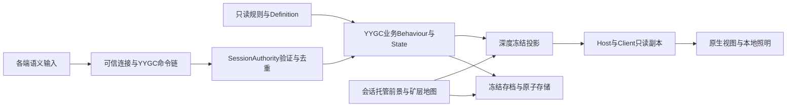

# Dark Nights Unity 技术架构

本页维护现行结构与不变量。当前开放范围见[地面基础玩法](GROUND_GAMEPLAY_BASELINE.md)，运行版本和验收见[执行状态](DEVELOPMENT.md)。联机、文件、地图、工具和照明分别由专项合同承接；历史决定及原文见[迁移摘要](archive/MIGRATION_HISTORY.md)。

## 唯一状态归属

正式游戏使用一个会话网络对象、每位玩家一个网络入口和YYGC管理的本地业务对象；个体不增加NetworkObject／NetworkTransform。Host唯一结算业务与RNG，各端表现只读冻结副本。

| 状态 | 唯一所有者 | 当前边界 |
| --- | --- | --- |
| 会话时间、ID、RNG、统计 | CampSimulationBehaviour／State | 仅推进当前允许的基础会话 |
| 信用点及角色库存、运动、装备动作／货袋 | 所属Economy／Actor／Hero Behaviour及State | 购买、手持使用、采集按现有短事务更新 |
| 船体、船货与乘员关系 | 原BuildingBehaviour／State与角色ActorBehaviour／State | 新地面局不装配；历史含船档按原状态恢复，不建立替代船体模型 |
| 导航、远征及一次交货身份 | ExpeditionJourneyBehaviour／State；Flow只协调配置和候选 | 原位船位、阶段、RunId／SettledRunId／LastIncome；共享到账仍由Economy同事务提交 |
| 星图已勘测位图与坐标航行目标 | 同一ExpeditionJourneyBehaviour／State | 不可变字符串位图随实际航迹累加，投影／存档同批冻结；个人拖动、缩放和未确认坐标不清雾、不持久化 |
| 前景与矿层格、耐久、储量 | SessionTerrain托管ARDMap／GridBusinessStateStore | Host唯一写入；初始矿床信息是静态元数据，不创建逐床对象 |
| 侧巢与幼虫阶段、姿态、HP | TerrainGameplayBehaviour／TerrainGameplayState | 每图有界单虫记录；静态巢位归冻结地图，业务经原事务提交，不恢复旧NPC世界 |
| 请求、可信连接、Ready、epoch、策略 | SessionAuthority及网络适配 | 不将连接、租约、请求队列写入存档 |
| 展示帧与客户端副本 | SessionProjector、WorldReplica、ObjectReplica | 深度冻结，无业务写权限 |
| 相机、选择、悬停、预览、照明缓存 | 各端表现上下文 | 不结算支付、HP、伤害或采矿 |
| 旧波次、建筑、工位、自动工作能力 | 原所属Behaviour／State | 实现保留，自动推进及旧命令按玩法范围暂停 |
| 地质事件 | GeologyEventBehaviour／GeologyEventState | 正式会话由SessionGeology组合，独立Lab由GeologyLabSession组合；每事件唯一状态，瓦砾归当前前景ARDMap，正式投影与保存随地图捕获 |

ObjectSession只组合能力、上下文、资源租约和索引，SessionEntityIndex只引用YYGC对象。旧GameSession／WorldState／Core实体运行世界不恢复；DTO、ScriptableObject及ViewData不成为第二份权威状态。

## 程序集与目录

正式源码为 `Game/Assets/DarkNights/Scripts`，资源为 `Res`；两者不加入namespace。文件名、主要类型、职责目录和 `DarkNights` namespace对应。

| 程序集 | 职责 | 项目依赖 |
| --- | --- | --- |
| Core | 只读Config、纯计算／可恢复RNG、Save及ViewData冻结合同 | 无Unity、YYGC、网络、表现、文件系统依赖 |
| Runtime | Objects业务与State、Session权限／时钟、Network、Framework装配及Save文件边界 | Core |
| View | 主视图、动画、UGUI／UITK、输入、制作参数及本地受光 | Core及引擎／YYGC表现接口；不读Runtime权威State |
| Entry | Bootstrap、网络／表现接线、明确委托注入及验收入口 | Core、Runtime、View；不结算玩法 |
| Editor／Tests | 制作、生成、只读检查与真实装配回归 | 按工具需要引用，仅Editor，不进入Player |

View需要Core照明算法时由Entry装配有限委托，避免直接依赖Core.Logic.Lighting。手写代码语言、summary、单主体和300行边界由[AGENTS](../AGENTS.md#代码与程序集)与ArchitectureGuard约束；历史覆盖映射见[回归迁移](archive/YYGC_UNIFIED_TEST_COVERAGE.md)。

## 装配、能力和事务

沿用AppStartup、YYGC DI、ObjectDefinition／PrefabRef、组件绑定及生成注册。SharedConfigs声明稳定RuleKey和能力参数，规则JSON不重复存入Definition。缺失配置、必要绑定、重复配置和非法身份在激活前失败，不以GetComponent、名称或子索引兜底。

EntityView的Actor／Building／Worksite主视图各拥有类别特有动画、锚点及阶段引用，直接继承YYGC ObjectView；Bindings用于真实外部依赖。当前装备继续通过Definition、ObjectInstance和Behaviour装配，视觉枚举仅为展示派生值。完整内容保留不表示全部进入正式调度。

Addressables预加载提供PreparedObjectDefinition租约；await位于事务外，ObjectSessionContext同步准备对象，依赖／初始状态就绪后统一激活。SessionScope和可写池状态不跨await／线程。

StartupResourceBatch有限并发准备独立对象／UI资源，全部成功后按原输入顺序移交；失败／取消等待所有请求收尾并释放晚成功租约。Chrome／PauseMenu／Help／Result／Hero五个UGUI面板仍按原顺序创建、绑定和激活。主菜单改由MainMenuCoordinator组合YYGC UIManager与MainMenuPanel，原生布局／主题／PanelSettings位于Res/UI/MainMenu；运行时独立UIDocument、字体和设置副本随宿主释放，隐藏后不挡游戏拾取，原UGUI主菜单作者Prefab保留但不再实例化。普通导入和构建不执行资源初始化来覆盖人工内容。

远征HUD沿用ShipEquipment原生UITK资源和YYGC UIManager：ShipEquipmentPanel组合四格图标、按需背包、商店与导航，ShipHudReadout只消费Actor／Crew／Journey冻结值。道具图标来自显式Definition.Icon；个人矿物仅在背包查看，继续由原货袋State拥有。UI/Inventory原生动作默认B，使用既有绑定覆盖／改键服务和Interaction Sessions。ShipTradeHud按角色、控制租约、连接代次和epoch撤销旧模态；星图仅操控室唤醒并在离开时关闭。原Chrome暂停／倍速按钮复用绑定移到Esc菜单，Menu／Help常驻按钮隐藏；不另建UI输入、物品或权限模型。

菜单房间服务唯一归SessionNetwork拥有，SessionRoomService组合有界LAN发现、RoomHost准入席位／票据与单个RoomClient尝试；这些是短期连接状态，不拥有游戏经济、地图或第二套业务世界，不写入存档。Core的RoomListingData／RoomLobbyData仅提供冻结副本，后者不再对应独立开局前大厅。菜单确认设置后经原SessionUiController入口直接启动同一FishNet与权威会话，只有就绪且未满员的房间回应发现。新角色的船舱出生策略从菜单会话创建时注入ObjectCampCommands，复用原角色／船舱权威事务，不改已恢复角色或快速测试；游戏侧SessionRoomAuthenticator仍只延伸现有定义兼容通过钩子，不修改YYGC／FishNet源码，不在此层决定游戏Ready。

ObjectMutationBatch先完成验证，保存可恢复状态和清理动作；支付、库存、占用及相关对象／地图变化安装后才通知。通知中不重入业务、退休同批对象或加载新世界。失败释放本次资源，不留下半扣款或半装配。采集细节见[地图合同](TERRAIN_GENERATION.md#采集事务)。

## 调度、权限和网络

正式地图塌方的作者输入沿`ExpeditionFlowDraft.Config.Geology`保存，冻结站点／最终进度分别归Core数据合同，不在Core推进事件。`SessionGeology`仅组合现有`GeologyEventBehaviour`对象引用，状态唯一归`GeologyEventState`，地图仍唯一归`SessionTerrain`。Definition资源、被动表现和权威实例沿现有租约／对象工厂创建与释放；完整静态地图不存本局EntityId／epoch，换图与恢复同事务交换，失败回滚。具体坐标、空间检查和同步保存见[地形合同](TERRAIN_GENERATION.md#cl02-map-integration-handoff)。

SessionClock用未缩放时间以60 Hz调用SessionAuthority，先处理接受顺序的合法请求，再推进当前允许的能力。倍速只在ObjectSession.Advance生效一次；暂停停止业务时间，网络、心跳、请求、UI和存储继续。旧经济生产、波次、工作与营地命令不因能力仍装配而恢复。

Host和Client使用相同验证入口；可信连接、控制租约、策略版本、epoch、序号及参数在执行点验证。运行协议与YYGC定义GuidV2属于不同版本概念，实际当前值由执行状态和源码常量确认。对象可靠完整投影及双层AMP1局部流的职责见[联机合同](MULTIPLAYER.md)。

## 场景对象与展示生命周期

地表起伏沿既有纯生成流水线输出最终格子；派生高度输入不成为第二份运行地形。天空与远景归JourneyEnvironment，逐图纯装饰归TerrainPreview的SurfaceScenery：View资产SurfaceSceneryLayout只拥有制作锚点，按规范化原始背景摘要绑定地图，通过Style引用打包；Runtime／Core的真实前景及保存、同步仍是原唯一所有者。近景按已确认局部支撑显示并沿原受光路径组装可见网格，换世界／epoch随原宿主释放，不增加碰撞、资源结算或逐装饰网络对象。Tuner共用同套表现，布局草稿可独立保存；合同见[地表环境](TERRAIN_GENERATION.md#surface-environment-authoring)。

场景是初始布局唯一可编辑来源。ScenePlacement提供稳定放置身份和实例初值，ObjectDefinitionLoader装配原生对象；分组直接子对象的sibling顺序是创建顺序。派生布局只读，不反向覆盖场景或另建Core实体。

干净矿洞白模由WhiteboxEntry接线，复用Bootstrap服务与ObjectSession。原生平地bounds和Worker的ScenePlacement冻结为LocalWhitebox布局，此模式仅允许一个worker、无建筑／工位且不带随机地形或远征；其他布局仍执行原有核心建筑校验。本地WhiteboxSession只组合已有角色引用，60Hz调用同一ActorBehaviour／MovementBehaviour，状态仍归ActorState；相机和动画消费冻结副本。入口不装配SessionNetwork、正式地图、菜单或玩家文件存储，不把该白模当作正式联机／存档验收。

入口模块白模可在同一本地入口显式绑定WhiteboxTerrainAuthoring，替代首片平地bounds。Prefab内Floor／Ceiling折线是唯一作者来源；WhiteboxModuleBaker从WhiteboxTerrainBuilder的冻结PlayableTerrain派生原生网格，12种坡形编码与正式TerrainShapeGeometry共用，不能表达的轮廓拒绝而不近似为台阶。运行时只创建该作者输入的SessionTerrain，交给既有MovementBehaviour地形后端，未改正式生成器。轮廓摘要不一致时要求显式重建；工作台重建在Prefab模式执行，保留Mesh资产GUID，不在打开、导入、Play时覆盖作者网格。四种入口为独立空间候选，不装配矿物、事件、生态或独立过渡块。

有色宽洞候选继续沿用此作者来源，允许相同X的相邻点表示精确垂直格边，其余斜段仍限全坡／半坡。可选TerrainArtwork与BackgroundArtwork引用独立SVG导出的前景／后壁Sprite，ArtworkFingerprint必须与轮廓摘要一致；旧图层失配时运行和工作台均拒绝混用。原生Mesh底稿保留，Sprite只提供外观，不成为另一份碰撞或业务状态。SVG描画范围与原生格形状分别核对，编辑态对齐不代表人物通行或拼接通过。

NaturalContours为独立纯视觉曲线研究Prefab，贝塞尔作者点列／SVG确定性细分后派生原生Mesh，不装配WhiteboxEntry、业务状态或运动后端，不将曲线冒充12种既有坡形。独立PreviewScene相机以overrideSceneCullingMask隔离，结束关闭预览并释放RenderTexture，不新增AudioListener，不停止用户Play或切换活动Scene。尺寸尚未确认，后续接入格地形须明确实际形状合同，不能以视觉候选替代碰撞／通行验收。

Host接管原ObjectInstance；动态业务走同一工厂。Client原子应用完整帧后创建无业务写权限的对象。SessionEntityViews按epoch／EntityId分发，换职业保持身份并退休旧实例。动画、物理回调、碰撞和UI不结算伤害。退出、加载及重开撤除旧绑定、订阅和插值；残骸、预览通过定义创建被动表现。

MapModule研究采用独立原生制作链：模块Prefab的闭合实体／端口经纯Core多边形裁剪精确落入现有整格与12坡形，Scene唯一拥有实例位置、连接及出生锚点。MapModuleBake冻结初始格形、出生及来源／内容摘要，运行入口比对源后显式安装到SessionTerrainNetwork；普通关卡的生成／地图应用来源保持。制作失败不补洞、重抽或反写作者源，场景内部轮廓覆盖在检查时拒绝。

MapModuleEntry经既有Bootstrap、UniTask资源链、SessionNetwork／FishNet及YYGC Stateful启动，复用SessionTerrain和ActorBehaviour／MovementBehaviour，不建立WhiteboxSession或第二份状态／运动。研究布局独立内容身份纳入既有握手指纹，并保留普通布局指纹字节；研究存储目录隔离，服务端拒绝保存／读档。MapModuleTerrainView只读已知局部副本，实际网格安装后才置PresentationReady；Unknown不当空地生成作者全图。此为实现合同，不代表Ready／联机运行已验。

正式关卡与MapModule共用SessionPresentationSetup装配实体副本、输入／UI、控制台接管、放置表现、效果及已有对象调试入口；研究模式不安装旧地图快速局。网络宿主同归AppStartupContext，AppStartup阶段只准备资源、装配并注册服务，研究Host请求在AppStartup Ready后提交一次，场景／启动取消撤销等待。会话对象创建预加载ObjectInstance后检查连接代次，调用YYGC CreateAsync并显式传入本会话ServerManager，保留原异常堆栈；失败统一由SessionNetwork记录与释放，不将Connect返回当成Host或游戏Ready成功。

主角外观Prefab不含场景专用ObjectDefinitionLoader；Loader与ScenePlacement仅存在于研究Scene实例，显式绑定正式Worker定义和原生视图。新Prefab保存前检查嵌套Loader并拒绝违规输入，不修改或绕过YYGC保存校验。Editor工坊只用本地画布／原生Undo；现有运行UI／投影继续使用原R3订阅生命周期，无需为Editor另加路由或依赖。操作及范围见[地图工坊](EDITOR_WORKBENCH.md#mapmodule-workbench)。

## 地面镜头取景

`View/CameraFraming/CameraFramingConfig`由`Res/Shared/Camera/ExplorationCamera.asset`统一保存本地地面取景。预设为16%、12.4%、10.5%、8%、6%及自定义，默认10.5%；选择预设只填入比例，Inspector直接修改比例后自动切为自定义，原生SerializedProperty负责Undo和保存。12.4%是旧zoom=2.8在1080p的近似比例参照，当前各预设均按相机实际画面高度保持目标占比。

参考人高默认0.48 Unity单位，随既有ActorPresentationScale换算，代表用于取景的人物站立外观高度。正交半高为`参考人高×表现倍率÷(2×占屏比例)`，原Stage逻辑像素缩放为`相机像素高×占屏比例÷(参考人高×表现倍率×100)`。PinewatchStage统一负责跟随、平滑及边界裁切，地面运行读取共享配置；临时滚轮倍率只归本端Stage，新会话重置。姿态／动画会使实际可见高度变化，参考人高可在同一资产校准。

正式远征、MapModule入口／M17及合作物理场景显式引用共享资产，新MapModule初始化检查配置就绪后再创建资产。既有营地与船舱取景继续读取原zoom及整船适配，未装配共享配置的旧场景保留原取景入口。配置属于本地表现，不进入业务状态、网络内容身份或玩家存档。

## 主角与输入

角色坐标唯一归ActorState.X／Height（逻辑像素），EntityPresentationBehaviour将其按100逻辑像素／Unity单位映射为ActorView根的世界x／y。外观子节点仅保留美术局部偏移，不另存业务坐标；地面Height=0时世界y=0正常。运行时手动角色命名为`Hero #<EntityId> (<RuleKey>)`，挂在Stage的Actors分组；UGUIRoot下的`Hero HUD (UI)`是原`ui.hero`面板，不是角色。面板定义键、Prefab和框架装配身份保持。

Host本地主角沿既有身份／控制租约校验取得最新冻结副本，SessionClock每个实际模拟步前只读捕获本地连接所属主角；SessionServer只保留最后一步的旧副本及epoch／tick，按剩余步长采样ActorPresentationSample。白模入口使用同一采样合同；多个追帧步取最后相邻步，无模拟步的渲染帧继续按余量显示，不做运动预测或写回，显示最多滞后一个60Hz模拟步。暂停、加载、epoch／角色／租约变化及传送丢弃旧采样，动作重置不插值旧动作时间，腾空／落地姿态仍读取当前真实支撑。远端角色继续原公共PresentationTimeline。LocalPlayerController先在LateUpdate提交本帧显示坐标，PinewatchStage再统一更新镜头及背景；旧空闲工人黄点仅在营地操作视角的非手动worker显示。

已选Hero沿ActorPresentationBehaviour→ActorView→SpineActorAnimation→官方SkeletonAnimation／SkeletonRenderer消费冻结副本；主角绑定清空旧PoseClip列表，旧帧／Clip／作者数据保留，其他既有单位继续原播放器。动作选择唯一归`Res/Objects/Hero/AnimationSelection.json`，来源聊天《整理主角 Spine 素材并制作预览》；作者源为`美术素材/角色/主角/主角-腾空腿部.spine`。地面用已选run5完整2.4秒，按插值后的实际位移／原基础步速映射，不把整段压入旧片段步距；骨骼主角离开move时保留行走相位。中立身体／速度前倾未制作，不自动替换。

SupportPlatform<0且已配jump的手动角色优先腾空。`jump_move／jump_idle`是jump2骨骼时间线与已有两套腿姿的派生组合，去除作者root平移；按实际横移速度判定，避免固定每渲染帧位移阈值随帧率改变。继续按已选预览把0.12～0.6秒映射到1秒并在长落保持末姿，实际接地立即切回地面；连续骨骼计算不再受12fps图片限制。未制作完整攻击／死亡动画时不冒用其他作者动作，攻击身体沿已有地面姿态、道具保留独立表现，骨骼残骸保留当前姿态淡出。

Spine播放器采用ManualUpdate：展示层传入绝对动作时间及本帧有效展示增量，AnimationState只在动作变化时SetAnimation，默认0.1秒过渡；轨道时间由展示采样控制，混合和骨骼物理随有效增量推进，暂停不另走Unity时钟。姿态与染色就绪后手动生成一次网格，关闭Renderer自动LateUpdate，避免Stage之后出现一帧旧姿态。编辑态重复idle预览不重建网格，并启用官方MeshFilter防Prefab覆盖设置；受击HDR／淡出通过属性块保留，不经Color32顶点裁剪。获批YYGC候选的ObjectView.Renderers缓存完整Renderer集，同时维护Sprite／Mesh子列表，渲染类型独立于物理维度；Awake及编辑器引用刷新均遵循此合同。通用边界、显隐和编辑器Watcher看到同一集合，2D Collider合同保持，不拆第二套视图；依赖来源及单文件修正见YYGC_CHANGES和DEPENDENCIES。解绑／复用／传送清轨道、混合及骨骼物理缓存；运行中不使用AnimatorController、root motion、SkeletonRootMotion或动画事件结算。

骨骼资源归`Res/Objects/Hero/Spine`，官方4.3二进制、straight-alpha／Bleed图集及RuntimeManifest保留来源和SHA-256；重建见`tools/hero-whitebox`。受光沿原环境场和局部补光，后者的运行绑定接受Renderer，旧Sprite作者配置保持；CampSpine Shader在线性空间消费贴图与作者顶点色。缺图只在派生输入隐藏，不修改作者工程或补画。后续Rise／Fall、受击、死亡等须有明确选取的作者资源，原AnimatorController候选已由用户选择Spine runtime取代。

主角翻转基准采用已选idle首姿的双脚底边中心。SpineActorAnimation显式配置左右腿网格插槽及小腿骨骼，HeroSpineAssetSetup将校准保存到SkeletonRenderer所在外观子节点。ActorView根继续承接权威脚底坐标，Facing围绕固定支撑中心镜像。SpineFootPlacement在每次采样前恢复上帧局部补偿，通过官方UpdateWorld钩子适配已接地姿态。ActorGroundSurface从本端已知地图读取实际格形，限定16逻辑像素身体宽度、2.5像素接触容差并核对格边连续和支撑高度，平坡过渡按脚下实际高度衔接。连续坡面先把外观基准贴到中间地表，idle再分别调整两侧小腿，每腿位移限8逻辑像素；行走沿原腿部动作。腾空、未知格、断崖／台阶和支撑不吻合时退出适配。正式会话只使用当前epoch已就绪的本地地图副本，白模及塌方Lab读取所属只读地图；适配结果仅属于本端外观生命周期。

未来物理边界：ActorState仍独占根位置／运动，Spine只持有可丢弃的外观状态；局部IK／次级运动使用官方Renderer.UpdateLocal／UpdateWorld钩子，先动画再局部骨骼接管再约束／网格，不新增通用动画引擎。参与玩法的ragdoll须由现有Host会话后端在同一手动PhysicsScene2D创建身体代理、明确动画／物理控制权、站起空间和恢复状态，并扩展冻结同步／存档闭包；客户端不能各自独立结算。仅作装饰的骨骼摆动不写业务状态。当前没有ragdoll组件、动态骨骼碰撞、拖拽玩法或新的协议字段，不因预留钩子宣称这些功能完成。

PlayerControl／Movement／Inventory及采集／手电能力共用ActorState。ActorBehaviour按PlayerControl装配及ManualControl状态选择控制路径，调用一次MovementBehaviour.Tick；运动结束后依据IMovementCapability.HandledByCabin决定是否直接推进现有装备逻辑。PlayerControlBehaviour集中应用已经校验的玩家操作，管理接管／释放、控制编号及输入清理，移动朝向由MovementBehaviour设置。自动控制的MoveTo及路径导航只提交本步目标／起跳意图，以实际位置判断到达，不绕过碰撞吸附目标。

LocalPlayerController挂在本机会话对象Dark Nights Session上，每个本地玩家一份，依据ControllerSlot选择本人角色，衔接输入采样、请求发送、HUD及镜头。HeroInputSampler继续作为普通辅助类保存短按及待发送操作，持续值30Hz限速、10Hz保活，跳跃按下立即发送。GameInputActions通过原YYGC Interaction Sessions提供本机输入。SessionPlayerControl负责可信连接、控制归属、参数／序号校验及默认角色、重连和断线协调，校验通过后调用角色的PlayerControlBehaviour.ApplyInput；超时与暂停调用ClearInput，策略失效调用InvalidateInput，具体状态修改统一归角色控制能力。超时清理保留控制权、输入序号及已生效惯性，重新接管的ResetInput另清连接输入序号；角色状态唯一归ActorState。

ActorPresentationBehaviour只消费冻结副本并驱动位置、姿态、动画及手持外观；Bind仅接收身份与单位定义，派工IssueOrder、训练Train及角色表现输入回调已退役。正式会话、白模与塌方Lab共用该只读绑定。仍被其他单位定义及原生动画资产使用的姿态采样继续由同一表现能力处理。

正式和MapModule共用`Res/Input/Gameplay.inputactions`的Player／Camp／UI三图及既有动作／绑定GUID与改键覆盖。Player/Move为A／D的1DAxis、Jump为空格、Crouch为S下穿、Sprint为左Shift、Attack为鼠标左键当前工具、Interact为E、Item1～4为数字1～4、ToggleLight为F；UI/Point提供鼠标绝对瞄准，UI/Inventory为B。ToggleMode虽保留Tab绑定，但正式LocalPlayerController的营地控制入口关闭，不能将该绑定当作当前已开放模式切换。资产中的Look／Next／Previous及部分设备绑定是保留项，当前GameInputActions并未以它们实现主角瞄准／换槽或完整手柄方案，不应据此宣称已支持相应操作；模板`InputSystem_Actions`不是研究入口输入来源。研究模式复用动作不等于装备／交互目标已全部装配。

MovementBehaviour统一执行玩家与自动单位的水平运动、跳跃、下落及碰撞。MovementHorizontalMotion在同一ActorState内维护HorizontalSpeed与TakeoffHorizontalSpeed；地面按所选速度预设过渡，离地完整继承速度。空中松键保留惯性，反打先刹车再有限反向，Face取最后一次非零方向输入。TerrainHeroMotion按真实脚底支撑决定地面／空中，沿现有身体扫掠裁切位移；PlatformMovement及船舱是同一移动能力调用的环境计算函数，没有独立配置、状态或Behaviour调度。坡道出口已执行横移时只接续纵向运动，不重复积分。历史飞行路径也由该入口执行，不据此恢复暂停玩法。

所有装配MovementBehaviour的Definition，其SharedConfigs必须有且只有一个MovementConfig（面板“移动”），在角色激活时冻结为纯只读MovementDefinition：

| 配置字段 | 行为 | 参数与来源 |
| --- | --- | --- |
| SpeedPreset | 手动角色基础步速、冲刺上限与两档速度过渡 | 非空预设冻结为MovementSpeedDefinition；零值“沿用balance”承接未指定预设的既有配置。自动移动显式单位步速继续优先 |
| ArrivalDistance | 目标点实际到达容差 | 原值0.8逻辑像素；自动步速仍读取ActorRuleConfig指向的balance单位规则 |
| CanJump | 是否接受主动起跳请求 | 关闭会清起跳缓冲；重力、已有竖直速度、下落和落地继续执行 |
| EnableAirControl | 是否接受空中方向修正 | 关闭仍保留离地惯性、松键阻力、重力和碰撞；朝向仍跟随输入 |
| AirSpeedRatio／AirAccelerationSeconds／AirBrakingSeconds／AirDragPerSecond | 有限空控的四项参数 | 原值分别为0.35／0.28秒／0.55秒／0.08每秒；空控参照读取所选预设步速，跳速和重力继续读取balance.hero_control |

2026-11-04速度预设采用主角手动visualize的七组候选。速度单位为逻辑像素／秒，过渡单位为秒；现行主角Worker选择“均衡探索”。“沿用balance”继续读原基础速度与倍率，两档目标即时切换。游戏参照项只按44像素碰撞身高换算速度，过渡时间为本轮候选。

| 预设 | 步速 | 冲刺 | 提速 | 回落 |
| --- | --- | --- | --- | --- |
| 慢速探索 | 72 | 108 | 0.28 | 0.20 |
| 均衡探索 | 80 | 120 | 0.24 | 0.18 |
| 利落探索 | 88 | 132 | 0.18 | 0.14 |
| 低步速／强冲刺 | 72 | 126 | 0.26 | 0.18 |
| 原游戏速度 | 112 | 176 | 64／2400 | 64／2400 |
| Minecraft速度参照 | 4.317／1.8×44≈105.527 | 5.612／1.8×44≈137.182 | 0.22 | 0.16 |
| 泰拉瑞亚跑鞋参照 | 3×60／42×44≈188.571 | 6×60／42×44≈377.143 | 0.40 | 0.26 |

预设仅平滑步速以上的Shift速度区间，普通起步／停步继续沿所选后端执行。原生马达以相对支撑面的真实水平速度推进目标，再受现有GroundAcceleration／GroundBraking限制；格运动、平台和船舱复用同一算法，接地保留本步已计算的过渡／继承速度。运行量继续只归ActorState，未增加冲刺计时或独立速度模型。动画步频在会话绑定时读取同一定义的冻结步速。

AirSpeedRatio是原地跳及反向修正上限占正常步速的比例；参考速度取正常步速和起跳速度绝对值的较大者。Worker／Archer／Spearman保留两项开关开启，其他六份单位定义默认关闭。编辑后重新创建会话／角色生效；所有已装配移动能力的定义身份及完整MovementConfig摘要参与会话握手和存档内容校验，包含开关、到达容差、预设选择及解析后的四项速度数值，编码域为`movement-speed-presets-v1`。协议38／存档v30字段形状沿原合同，内容身份改变后按既有匹配规则处理旧客户端／存档，旧文件保留。输入超时／控制租约撤销只清输入，保留已生效惯性；传送和船内固定放置清除速度。旧HeroMotionBehaviour、HeroAirControlConfig及HeroAirControlDefinition已退出Game；MoveToConfig只保留MovedFrom来源名，原脚本.meta／GUID延续。

每位玩家首次Ready创建专属worker，重复Ready不增员；真正重连与加载的接管区别见联机合同。主角、相机、菜单和改键各有明确生命周期，不共享客户端选择状态。Host本地主角在权威模拟后冻结即时展示，验证epoch／槽位／租约；远端仍消费正式副本和插值，不用本地展示替代网络诊断。

### 物理后端替换与数值域演进

本节为2026-11-03用户要求的架构合同，后续“开始执行开发”及“全部开发完成”授权了PH-01～04游戏侧开发。当前格运动与显式装配的`unity-2d-float-v1`候选按会话互斥；未绑定PhysicsProfile的原入口继续格运动。候选采用Host权威动态Rigidbody2D与有限力马达，手感、双端及恢复验收分开记录。客户端预测本轮评估为暂不启用，先取得权威同步的弱网测量；定点后端没有启用。ActorState及当前物理合同仍为float，ActorSnapshot.X的double不能恢复源精度。

**替换单元是会话物理求解后端及其数值域，不是一个全局float别名。** 后端内部若使用Unity浮点刚体，未来改为定点数通常还需替换碰撞、接触、约束和数学实现；转换网络编码不能把原生物理变成确定性求解。架构应保留以下责任边界，具体类型随首个获批接入切片建立，不预建通用引擎框架、空接口／目录或并行权威状态：

| 边界 | 后续接入约束 |
| --- | --- |
| 输入和玩法意图 | 沿既有可信连接、EntityId、epoch／租约和序号验证；Move／Jump／持续施力／一次冲量分别表达。控制器、道具和技能不持有Rigidbody2D／Joint2D引用，不直接设引擎位置、速度或调用AddForce；引擎调用集中到Runtime物理适配 |
| 运动规则与物理求解 | MovementBehaviour仍为角色唯一运动入口；目标速度、地面／空中控制和起跳规则按冻结配置求解，后端拥有实际运动、碰撞和约束计算。业务侧只提交语义操作并读取冻结结果，不依赖Unity碰撞回调的调用顺序或接触数组下标 |
| 状态与生命周期 | 所属YYGC Behaviour／State仍拥有业务身份与每步权威结果，后端刚体及内部求解缓存是会话内执行资源，不另建游戏世界。每个tick只允许一次运动推进和结果提交；失败、重建、加载和退休同步处理后端与State，不能只回滚一边。原格运动与新后端按会话互斥启用 |
| 坐标与数值 | 明确逻辑长度、引擎单位、角度、速度、力、冲量和时间单位，统一有限范围与转换规则；现有100逻辑像素／Unity单位仅在适配／表现边界换算。权威计算不得经显示float坐标再读回；真正定点后端内部不以float往返作为运算捷径 |
| 制作输入与碰撞 | 场景／模块作者源和现有地图仍唯一；后端碰撞体由同次权威形状、单位和地形revision派生。量化、凸分解、坡形或容差变化须进入内容身份并独立对照，不用人工Collider或引擎近似形状悄悄改地图；挖掘后更新碰撞遵循同一tick屏障 |
| 网络和表现 | FishNet负责传输与必要预测／校正适配，不能让原生组件及其序列化成为业务合同。动画、镜头和声音只读每步冻结结果；物理根与表现平滑分离且各自只有一个写入者，不让Unity插值、FishNet图形平滑和手写插值同时驱动同一Transform |

Core/Physics/ActorMotionInput是无引擎依赖的冻结单步合同，包含角色ID、已应用倍速的秒数、方向、跳跃／下穿／持续键及自动目标／速度；它不是网络输入或恢复状态。MovementBehaviour准备跳跃缓冲并在finally撤销边沿／临时目标。格运动交给GridActorMotionBackend，沿用地形／平台／飞行、船舱／坡道接续；候选则向PhysicsSessionBehaviour提交意图，不能逐角色调用Simulate。SessionActorMotion在正式、研究和白模入口形成唯一批次：所有BeginMotion → 一次Solve → 所有FinishMotion。不会在运行中切换后端。

PhysicsSessionBehaviour是箱子和绳索的YYGC状态所有者，PhysicsWorldState只存负ID道具及按OwnerId识别的约束，正ID角色仍唯一归ActorState。UnityPhysicsBackend及NativePhysicsBodies／Terrain／ActorMotor是内部执行资源：独立LocalPhysicsMode.Physics2D场景手动模拟，不加FixedUpdate、不改全局模拟模式、不对表现根挂刚体。原生缓存只在初始化、显式位置变化或恢复时设姿态；普通行走使用AddForce(Force)逼近目标速度并限制加速度／制动，跳跃使用一次Impulse，重力／早松键沿原规则。100逻辑像素为1Unity单位，质量kg，角度度；候选Profile的地面加速／制动不是原即时启停已获手感认可的替代结论。

环境吊绳通过`environment.hanging-rope` ObjectDefinition装配。`SharedConfigs`中的`HangingRopeConfig : IConfigData`唯一保存运动、质量、碰撞宽度和显示参数，`HangingRopePlacement`只保存DefinitionReference、固定点、绳ID及起始负ID。冻结的Core `HangingRopeDefinition`携带定义GUID／配置摘要及初始拓扑，并将绳节纳入原负ID物理闭包。固定顶端及HingeJoint2D属于NativeHangingRopes执行缓存。抓附继续由PhysicsSessionBehaviour拥有，保存绳ID／弧长／目标绳节；Climb沿原HeroInput传至ActorMotionInput，挂绳时互斥替换普通地面马达，上下移动抓点、左右有限助摆，离绳保留实际速度。当前固定点为世界安装，空绳按自然物理运动。运行与多人边界见DEVELOPMENT。

M17均衡配置采用12×0.32世界单位、每节0.1kg、攀爬0.75世界单位/秒、水平助摆加速度1.6世界单位/秒²、同向水平助力阈值3世界单位/秒及切向阻尼0.24/s。助力在阈值前最后25%范围渐退，反向输入可制动。NativeHangingRopes按角色实际质量施加助摆力，按各刚体质量和相对固定点的切向速度施加阻尼，覆盖空绳绳节及抓附角色。新增参数及求解规则版本进入PhysicsProfile摘要。表现继续消费同一公共时间线，每物理节采样4点、通过原节点及两端，曲线相对直段最多偏移0.02世界单位，保持权威碰撞和抓附位置的原归属。

吊绳定义及Prefab归`Res/Objects/HangingRope/`，通过既有定义目录与Addressables注册。ObjectSessionResources在事务外预加载当前物理配置所需的定义，权威端准备HangingRopeBehaviour实例并由YYGC的IStart激活，退出时先释放物体再释放资源租约。各端HangingRopeView通过同一定义创建、绑定并激活，消费公共物理时间线，换epoch／连接时退休。吊绳物体拥有冻结配置与装配生命周期，绳节姿态和抓附状态继续唯一归PhysicsSessionBehaviour／PhysicsWorldState。未来玩家部署复用此对象定义及求解能力，动态拓扑增删、可信锚点校验、消耗事务与动态实例恢复属于后续切片。

存在权威地图的物理场景以PlayableTerrain上沿作为顶部外边界，角色投影／保存高度上限扣除44像素身体高度；不能再沿平地HeroControl.MaximumHeight在洞内插入隐形横墙。无地图平地保持原规则，形状及边界版本进入Profile摘要；顶部边界变化不修改角色跳跃数值。

原生碰撞由当前权威Map的整格及12坡形派生，整格按行合并后生成CompositeCollider2D；不读取可见网格或客户端Unknown。地图或revision变化在下一物理步前统一更新，装备挖掘在该步物理结果提交后处理。检查点TerrainRevision记录本步**实际碰撞使用**的revision，诊断另记录随后发生的真实地图版本；不能把步末挖掘版本冒充已求解几何。角色是脚底原点16×44逻辑像素盒，固定旋转；道具初始位置／尺寸唯一从Scene的PhysicsPropPlacement精灵边界冻结，质量来自Profile；Profile不保存并行布局。候选拒绝旧单向平台及旧飞行意图，原入口继续格后端处理这些历史路径。

原生角色接地按相对支撑点速度在支撑法线上的分量判定，允许沿坡向上或随动态支撑上升。接地马达沿实际坡面切线施加有界加速／制动力，起跳后沿空中水平控制推进。支撑形状查询、相对法向速度规则及切向施力版本进入PhysicsProfile内容摘要。

PhysicsWorldSnapshot冻结关联角色、箱子、绳索、速度／角速度、起跳门闩、输入确认和地形身份；不包含原生接触缓存。网络协议37在既有WorldWire完整投影追加物理闭包，核对角色姿态、租约和端点覆盖；保存v29附加physics字段，清输入序号／租约，恢复在原世界交换事务内分别写回所属State，并整体撤销原生缓存。动态支撑允许接地角色有竖直速度，不再用“接地必为零速”误拒合法箱上站立；原格合同保持。Host所有物理表现共用相邻60Hz采样，客户端共用原PresentationTimeline，不叠原生插值／NetworkTransform。

E连接／解除沿原SessionRequest→SessionPlayerControl路径，执行点复核本人租约、策略、暂停、存活、端点和距离。物理研究场景的新建角色配正式矿镐以检查箱上挖地；不向原模块研究或正式新局追加装备，接管／重连／加载不补发。诊断经原工作台显式启动，记录起始v29世界、冻结规则／移动指纹、最多600步输入与接触、最多16次地形变化；达到上限停止而不丢起始帧。导出复用原地图编码，无自动文件写入／日志订阅；这些资料不宣称原生求解器跨平台确定性。

物理时间仍由会话单一60Hz调度点驱动：验证并消费本步输入／外力 → 准备控制与约束 → 模拟一次 → 收集接触及支撑结果 → 由所属对象提交状态／权威事件 → 冻结网络、存档及表现输入。后续若接FishNet预测时钟，先明确与SessionClock的唯一推进关系；不额外叠加独立FixedUpdate、TimeManager或Render Update推进。一次冲量和关键事件按tick／序号去重，Unity碰撞回调不能直接支付、扣血或改变权威矿格；重演的表现事件不得重复结算。

**回放、纠错和恢复的边界覆盖相互作用的物体。** 人物、箱子、移动支撑和绳索以稳定实体／约束身份关联，检查点需覆盖相关物体的位姿／速度、马达状态、支撑关系、约束、输入确认及地形revision。后端若有无法导出的接触／休眠／warm start缓存，必须记录恢复方法及其对重演结果的限制，不把“恢复位置和速度”声称为完整确定性恢复。确认过的业务变更与预测计算分开，校正或重演仍沿原事务和去重入口，不恢复第二份经济／HP／地形世界。

网络投影、恢复检查点、持久存档和展示帧职责分开，避免把ActorViewData或ActorWire充当完整物理恢复数据；现有通用显示快照没有为物理预测签署该能力。新增后端身份、数值格式／比例、物理规则、形状和约束配置须纳入内容握手与明确的协议／存档版本；一间房使用同一权威求解配置，不能让普通客户端本地切换后端。迁移前先核对原生State同步、ActorWire、配置摘要、保存校验及派生资产全部边界，不只检查展示载荷。定点权威原始值不得通过float后再保存为“精确检查点”；旧档只允许显式、可审查的转换或按原格式拒绝，不自动覆盖、删除或许诺跨后端轨迹一致。

排障随首个物理切片接入有界记录：绑定源码／依赖／后端与配置身份，按epoch／tick记录输入、有关物体状态、稳定接触／支撑身份、地形revision及校正前后差值。记录覆盖起点、校正／异常前后的有限窗口，禁止每帧输出全世界或反馈自身日志；应能区分权威求解误差、预测差异、重复推进及显示时序错误。相同固定输入的暂停恢复、单步／多步追帧、帧率变化，以及推箱／移动支撑／牵引和动态地形均列为后续获批验收项。浮点后端不据此许诺跨平台逐位一致；确定性后端另核验完整数学、随机数、遍历顺序和检查点闭包。

后续顺序与授权边界见[物理演进切片](ROADMAP.md#cl-physics-evolution)。本节不升级依赖、不修改YYGC、不默认增加每实体NetworkTransform、锁步或回滚；定点数或新物理库的引入需在实际问题、候选和影响明确后单独决定。

## 身份与当前存档恢复

RuleKey表示规则；DefinitionGuid／Key表示定义身份／查找键；PlacementKey表示作者放置；EntityId表示世界关系；FishNet ObjectId表示传输实例；槽位／连接代次、epoch／PolicyRevision表示会话身份。正式旧整数ID为0，不恢复Kind／整数兼容；独立LAN Sample的LegacyV1保留隔离边界。

保存从所属State及最终两层地图捕获冻结数据，文件后台只编码／写入；恢复先完整校验，在未激活上下文准备对象和候选地图，同步提交后增加epoch、退休旧世界并重新Ready。失败保留旧世界／原文件。连接和控制所有权不从文件恢复，详细字段及零值约束见[存档合同](SAVE_FORMAT.md)。

## 本地照明与有界日志

照明身份、持有和开关归角色State；LightEffect组合环境光源及指定精灵补光，不拥有第二份装备状态。相机共享有界环境光场，View后端仅消费冻结光源和已加载地形；挂载、材质、URP回退及退休见[照明合同](LIGHTING.md)。

YYLogger沿用General／Runner／Network／Gameplay通道。业务消息和横幅经SessionEventJournal投影，CampHudBehaviour写入Gameplay／Info，普通信息青蓝色、玩家危险提醒橙色；真正运行Warning／Error维持原等级。HUD消息容器保持隐藏，F10承担有界查看。

正式装配关闭Smart Console的ShowApplicationLogs，由SmartConsoleLogBridge转入日志：待处理最多200条、每帧12条、单条2048字符，显示达到400条后轮换清空。只拦控制台自身TMP缺字反馈，其他警告不吞掉；运行时中文回退使用独立字体副本和单张1024²图集。退出释放队列／订阅／运行字体，断开作者图集和材质引用，不改作者资产。原根因和失败见[内存事故](archive/UNITY_MEMORY_INCIDENT_20261007.md)。

## 作者资源与变更边界

保留Bootstrap、原Prefab、动画、场景布局、人工覆盖、GUID、规则来源和原始素材。专用资源归Res/Objects，共用归Res/Shared，Original与Custom分开。Addressables的条目／分组和物理目录分离；Debug Hub开发模板的既有Resources加载例外见其专项规范。

### 效果资源归属

2026-10-15用户要求效果目录归一。可复用／独立效果的Prefab、Definition、粒子材质及新制贴图统一在 `Res/Effects/<效果类别>`；Arrow、Floating、Command、Audio、Ballistic、Geology沿同一根目录。Geology的原生粒子为 `Geology/Debris.prefab`，对应事件Prefab、局部Definition及编辑标记归 `Geology/Event`，碎岩／尘雾／石粒纹理和材质就近保留一份。当前混合版的有限接触计算只在冻结配置时生成私有只读轨迹，最终轮廓推导同一前景的整格包络；View按权威时间采样，落地网格按实际占用位图裁切。效果不拥有地形、伤害、奖励或持续物理状态，整格保守包络不等于颗粒像素级碰撞。

对象造型和作者原始美术／音频输入继续由原来源目录唯一保存，效果通过引用复用；不能为归一目录复制同份源文件。已有资产改归属使用AssetDatabase搬移并保留meta／GUID、Address及Definition身份，校对生成入口路径、嵌套Prefab和资产引用，不用初始化重建覆盖用户修改。

仅指定空目录可执行首次初始化。框架修改、升级和补丁接入按AGENTS取得具体范围授权，逐文件记录[YYGC账本](YYGC_CHANGES.md)；不默认增加锁步、回滚、ECS、房主迁移或未经测量的拆流。

CL-06普通循环沿用SessionJourneyControl／SessionExpeditionControl和原SessionJourneyTransfer；候选票据在提交前复制成值，不在提交后读取可能已归还的State。地面→空载体与空载体→审核图均通过原Terrain.Swap，巢穴、地质对象及两层地图同批切换；beginEpoch后原可靠完整投影与局部流重新Ready。自动飞行不占用驾驶席，个人选择、UI交互会话和近景镜头不写业务状态。
