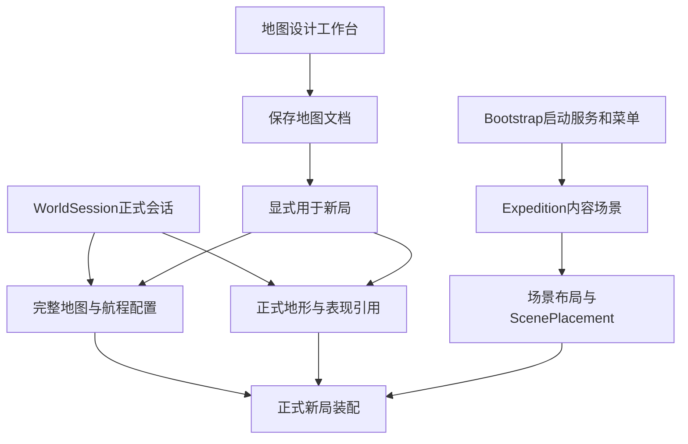

# 编辑工作台、场景与诊断操作

本页集中原生编辑器入口、草稿／保存、独立预览和只读运行诊断。日常打开 `Dark Nights → 工作台`；地图权威规则、工具能力、照明及执行批次分别查专项合同。本页不以历史测试计数声明当前画面通过。

CL-00后独立洞穴工作台默认关闭喷气，沿用真实基础跳跃；原喷气勾选仅供显式历史预览，不能据此签署正式矿洞通行。正式商店及Debug Hub添加均关闭喷气，定义、原GUID和作者资源保留。

## 导航与作者编辑

主工作台按业务组织为“游戏／设置／开发”。默认打开关卡装配页；常用内容直接显示，各模块复杂功能、作者源文件和低频操作统一放入默认折叠的“扩展”，首次展开才创建Inspector或辅助目录。

| 分组／模块 | 常用内容 | 扩展与保存归属 |
| --- | --- | --- |
| 游戏／关卡 | Bootstrap、正式内容场景、正式地图引用、活动场景及Play来源说明 | 正式会话与地形来源定位、完整场景／实验／样例目录、balance.json与pinewatch.json、主菜单和暂停／帮助／结果界面；场景和原生编辑器继续拥有作者修改 |
| 游戏／飞船 | 正式船体、补给商店、交货终端、航程开关和超时摘要 | 正式会话参数、原星球／泊位／过场草稿、游戏HUD／背包／飞船服务界面作者源；直接会话参数与地图草稿的应用范围分别说明 |
| 游戏／地图 | 唯一地图设计工作台入口 | 原地形业务／耐久窗口；不在主工作台复制地图生成、环境或装饰参数 |
| 游戏／角色与装备 | 主角、手电、矿镐、手枪、炸药的原生工坊入口 | 完整对象工坊、资源注册Viewer、采集校验及矿床来源；喷气背包暂退，不列常用快捷项，原资产保留 |
| 设置／键位 | 默认Gameplay.inputactions及其原生编辑入口 | 默认动作和绑定数量摘要；玩家本机改键仍在游戏设置，沿原YY输入服务持久化 |
| 设置／图形 | Linear、当前质量档及渲染管线摘要，原生Quality／Graphics设置 | 已加载正式内容场景的显式光照引用、原光照调参台；不为查看摘要加载场景，不新建玩家图形设置 |
| 开发／开发工具 | 正式端口、协议／存档格式及显式刷新的连接摘要 | 固定十槽文件信息／实际或预计存储目录、构建器实际场景与默认Mono输出、主角Profiler及原安装／迁移／构建／专项验证命令 |

导航元数据来自DarkNightsWorkbenchCatalog.Tasks。分类与内容分别滚动，窄窗口卡片纵排；左栏常规212px、小于900px缩至168px，窗口最低680×480。全局搜索覆盖模块工具、扩展来源、场景、维护命令和旧菜单文字；Ctrl／Cmd+K聚焦，Esc／清除返回当前业务模块。搜索作者来源会展开对应模块扩展。旧journey／ui导航迁至飞船，scenes迁至关卡，maintenance迁至开发工具。

正式游戏侧Unity菜单仍只保留 `Dark Nights → 工作台`。全页重复的场景快捷条、独立技术型“界面资源／星球与航程／工程维护”主分类，以及主页重复嵌入的采集校验撤下；原工具、场景、命令和资源保留。场景样例／模板／退役项继续按用途在关卡扩展中查询，退役项只定位。安装／迁移／构建仍须显式点击原命令确认，浏览或搜索不执行。

原生YY、AnyRuleD及第三方入口保持隔离，不复制Definition编辑树或另建保存模型。各来源面板可同时存在，切页／关闭时逐一释放Inspector和定时订阅；独立工具窗口及其草稿不随主工作台关闭。连接和存档摘要仅进入或显式刷新时采样，存档只检查固定十槽文件信息，不解析世界或定时扫描磁盘。

### 业务导航待验操作

当前已完成编译及入口引用核对；以下交互、布局和运行门控仍需后续定向核对，不以主窗口能打开替代全部通过。

| 操作 | 预期与关键边界 |
| --- | --- |
| 首次打开及恢复旧journey／ui／scenes／maintenance导航 | 首次为关卡；旧状态落入对应业务页，无空白页，不改当前场景或正式配置 |
| 切换七个模块、反复展开／收起扩展，关闭重开 | 常用内容精简、复杂来源只在展开后创建；切页释放辅助句柄，原生工具及其未保存草稿保留 |
| Ctrl／Cmd+K、Esc、搜索旧界面名称及原维护路径 | 搜索能找到扩展工具；作者来源跳至所属模块并展开，搜索与定位不触发安装、验证或构建 |
| 在680×480及常用宽窗口查看长路径、多来源与场景目录 | 标题区独立，正文可滚动；关键按钮可达，路径换行，不靠放大窗口才能完成操作 |
| 飞船扩展切换布局、样式、主题和PanelSettings | 文案对应真实职责，默认优先布局；打开／编辑／保存仍转交原作者资产，不复制HUD或重建UI |
| 查看键位／图形并打开原生编辑器 | 区分项目默认与玩家本机覆盖；仅打开不改键、不切画质、不把Linear改为Gamma |
| 非Play与既有Play中查看开发／光照入口 | 作者编辑和场景切换受门控，诊断仍可打开；刷新只读数据，不连接、不切权限、不自动Play |
| 展开开发扩展、刷新十槽、查看构建清单 | 正式／快速局目录标识正确；无删除、迁移、世界恢复或构建动作，实际构建输入与摘要共用来源 |

## 工作台接入与业务边界

本节承接2026-10-26的WBI-01～12盘点及随后用户授权的最小接入。当前导航和源码已按上表组织，实际编译、未验项及候选身份见[执行台账](DEVELOPMENT.md#cl-map-workbench-redesign-status)；范围与后续切片见[模块计划](ROADMAP.md#workbench-integration-candidates)。界面已接入不等于逐项交互或运行验收通过。

### 正式游戏装配关系

Bootstrap默认内容场景仍由`GameSessionStartupModule`和`RandomLevelEntry.ExpeditionScenePath`指定；关卡页展示与定位，不新增场景选择合同。地图文档与Unity场景不是一对一关系。Editor从已保存关卡Play时沿`ScenePlaySelection`转交Bootstrap服务；普通新局、存档恢复和F1快速局保持各自来源。

| 盘点项 | 当前落点与保留边界 |
| --- | --- |
| WBI-01 正式装配 | 关卡页展示启动场景、内容场景、正式完整地图；会话／地形表现来源在扩展。当前编辑文档是否与正式完整结果一致仍由地图工作台核对，主工作台不扫描文档或替作者应用 |
| WBI-02 实际试玩 | 关卡页根据活动场景说明当前Play入口，并明确普通新局／继续／F1来源差异；不自动Play，不修改本机试玩覆盖 |
| WBI-03 地形来源 | 关卡扩展定位正式TerrainProfileConfig的CaveStyle，制作仍归地图工作台；不新增第二套完整资源链面板 |
| WBI-04 航程应用 | 飞船页明确：地图“用于新局”保留正式Enabled、Navigation及准备／到达超时；扩展分别提供正式会话编辑与原航程草稿入口，安装语义保持 |
| WBI-05 对象与服务 | 飞船与角色装备分模块提供原生Definition入口；复杂能力、资源Viewer和采集校验进入扩展，场景摆放继续在原场景编辑 |
| WBI-06 光照 | 设置／图形提供原生图形设置和扩展光照调参入口；只读取已加载正式场景的Lighting引用，未加载时说明需核对，不借默认目标宣称正式已匹配 |
| WBI-07 规则 | 关卡扩展同时提供balance.json与pinewatch.json原作者来源，显式区分数值与关卡元数据；暂停波次不恢复 |
| WBI-08 UI语义 | 飞船扩展更名为“游戏HUD、背包与飞船服务界面”，说明四格、B背包、补给与星图共用布局；下拉优先布局，区分样式、主题与缩放渲染设置。主菜单及仍用UGUI来源归关卡扩展 |
| WBI-09 输入 | 设置／键位定位默认动作资产，扩展列出默认动作及绑定数量；不复制玩家覆盖或改键服务 |
| WBI-10 存档 | 开发扩展显示本机启动参数解析的预计正式目录，运行时读取SessionNetwork实际目录；显式刷新十槽占用和最近文件，不读回世界，不删除／迁移／覆盖 |
| WBI-11 联机 | 开发页显示UDP27777／27778、当前协议／存档格式及连接／Ready／槽位快照；内容兼容身份和复杂诊断继续由原握手与F1提供，不新增可编辑网络参数 |
| WBI-12 构建 | 开发扩展直接读取GamePlayerBuild共用的场景清单和Mono默认输出；命令仍由原构建器执行。场景列表／后端／输出行为保持，未执行构建 |

### 源码与生命周期

- [导航目录](../Game/Assets/DarkNights/Scripts/Editor/DarkNightsWorkbenchCatalog.cs)、[窗口](../Game/Assets/DarkNights/Scripts/Editor/DarkNightsWorkbenchWindow.cs)和[页面生命周期](../Game/Assets/DarkNights/Scripts/Editor/DarkNightsWorkbenchPage.cs)只负责入口和只读展示。
- [游戏模块](../Game/Assets/DarkNights/Scripts/Editor/DarkNightsWorkbenchGame.cs)、[设置模块](../Game/Assets/DarkNights/Scripts/Editor/DarkNightsWorkbenchSettings.cs)、[开发模块](../Game/Assets/DarkNights/Scripts/Editor/DarkNightsWorkbenchDiagnostics.cs)按业务读取原来源；[作者来源面板](../Game/Assets/DarkNights/Scripts/Editor/DarkNightsWorkbenchSources.cs)转交原生编辑／保存。
- [正式启动](../Game/Assets/DarkNights/Scripts/Entry/GameSessionStartupModule.cs)、[实际地形接线](../Game/Assets/DarkNights/Scripts/Entry/Terrain/RandomLevelEntry.cs)、[地图应用](../Game/Assets/DarkNights/Scripts/Editor/Terrain/TerrainDocumentStore.cs)、[存储位置](../Game/Assets/DarkNights/Scripts/Runtime/Network/SessionSaveLocation.cs)及[构建器](../Game/Assets/DarkNights/Scripts/Editor/GamePlayerBuild.cs)继续是相应行为的来源。
- `MapWorkbenchReleasePage`是未构造的旧页面，地图应用入口在文件菜单；旧生成窗口与专用导出器已保全退出活动工程，参考算法仅供Editor测试。`ExpeditionFlowWindow`仅承接旧草稿迁移。旧地图、资源GUID和用户存档不因入口整理改写。
- “已用于新局”、编译通过、真实画面、Play、Player、联机及保存恢复是不同结论；工作台不把引用存在或历史报告显示成当前验收通过。

## 地图设计工作台现行入口

入口：`Dark Nights → 工作台 → 地图 → 地图设计工作台`，英文名为`Map Design Workbench`。2026-10-28按确认原型改为四区：最左配置选择库、独立制作模块、主画布与八步过程、当前模块基本／高级配置。模块按地图配方、空间生成、地图内容、地图表现、文件输出分组；取消三Tab和笼统扩展总菜单，实验在导航底部明确单列。窗口类型仍为`MapWorkbenchWindow`，保留原GUID与作者草稿；实施和验收见[执行状态](DEVELOPMENT.md#stage-cl)。

1. **配置与调参**：顶部只读显示当前地图名称，右侧标明已保存／未保存或只读；文件选择统一走左侧列表，文件菜单保留新建、打开、保存、另存为与预设导入。首次保存前始终标为未保存。新建产生干净的未命名配置；导入地图配置／会话配置时创建未命名副本，不覆盖来源。其他页面只编辑当前配置，按有效能力显示参数，不显示作者图／新旧切换。空间组分别调整入口、道路、矿室与地表。输入按约80ms短间隔合并，持续拖动不反复推迟开工，单个后台纯计算作业串行生成；只提交匹配当前输入的结果，过期／失败结果保留原图，普通字段变化不重建属性页。算法与种子模块选择固定／随机／种子池策略，顶部“按策略生成”显式解析本次种子；普通调参不重新抽样。固定模式复用指定Seed，池模式只从已配置条目中选择。保存策略、实际种子与完整地图，游戏只加载结果。状态区分地图计算、画面更新和完整同步，耗时按输入合并开始至完整画面实际就绪计量，不把候选计算完成当作画面完成。
「算法与种子」集中布局、矿物算法与种子策略；文件操作在左侧配置库和「地图文件」，预设导入在配方高级区。连通洞室支持区域矿物／近壁矿团，天然洞穴支持基础矿床／近壁矿团；切换布局不暗换矿物算法、不清空覆盖，不兼容时明确提示并等待作者选择。旧固定底图不再是输入类型。地表明确选择基础噪声／地貌轮廓，只显示对应有效参数。

各模块统一分为基本配置和默认收起的「高级配置（扩展）」：基本区放算法、形状、常用预算与开关，高级区放精确尺度、随机修订、完整配方、诊断和实验；不因收起而删除参数。入口形状、道路结构和矿室配比改为下拉，九／五／四种选项完整保留。凹谷多边形独立开关在入口高级区，默认不关闭；它不控制两段首室连接。环境逐层素材、岩壁／背景完整字段及恢复、塌方精确坐标、装饰逐项锚点、泊位／航程与本机实验均保留在所属模块高级区。

打开配置时先显示文件内保存的完整地形，画布标明「文件内已保存结果」；更新生成器不会自动消除旧结果中的平台。选择「文件 → 用当前种子重新生成」按当前规则重做，不从种子池重抽；原地形仍留在文件中，画布标为「当前规则生成 · 尚未保存」。即使参数未变，新生成结果也属于未保存内容，须保存／另存为后才能用于新局。顶部「按策略生成」继续按所选策略决定是否换种子。

2. **看图与比较**：画布上方提供设计／渲染模式及七个图标：适配画布、格线、区域、连接、墙后矿、站点、装饰旗标。适配画布是一次取景动作，其余是显示开关，开启时高亮，悬停显示中文名称、当前状态及操作；装饰旗标仅用于设计模式，格线同步1／2快捷键。显示开关保持镜头且不改作者输入、保存状态或请求地形重建，只读查看与加载期间仍可使用。拖拽平移、滚轮缩放使用共用画布，渲染模式同步真实制作相机。按住对比查看上一次有效画面并明确标注来源，松开恢复；切模式撤去旧比较图，保留当前镜头／缩放与选区。撤销／重做恢复原生作者草稿并自动预览，切页保持画布。渲染模式中同种子地形变更继续使用原稀疏格事务，纯矿层变更只替换矿层输入；新渲染未就绪时由当前同版白模垫底，平移补页不反复切白模。

模式控件独立于右侧图标，使用原生`ToggleButtonGroup`组成「设计模式｜渲染模式」分段，禁止多选与空选；选中项使用实色底。右侧六个显示开关使用原生`Toggle`值与`:checked`状态，开启时实色底、反色图标及底部短条，关闭时中性底；hover不改变开关填色，focus仅显示独立边框，禁用另作淡化并说明原因。「适配画布」仍是一次性Button。原生控件保留Tab／Space等键盘操作，窗口状态通过`SetValueWithoutNotify`同步，不从hover／focus或CSS类反推开关值。
3. **局部矿物**：区域算法下点击画布或选择区域，基本配置调整矿团数／储量并重排；高级配置提供本区种子、重新绑定和全图配方。局部重排保持洞形、侧巢及其他区数据／编号，空间不足减少本区产出、不借邻区预算。布局／空间身份改变后旧覆盖保留为过期并跳过；可显式重新绑定或清除，支持Undo。历史地图缺少保存计划时不能假造区域，需明确重新生成后才局部编辑。近壁矿团提供数量、侧巢及高级内容种子／修订；基础矿床只显示有效供给与诊断。
4. **环境与扩展**：环境页显示实际纹理层及逐层开关，逐层高级可编辑素材、裁切、缩放、高度、视差与颜色；云独立。环境参数直接更新当前远景与装饰，保留地形、地下背景和相机；岩壁／三层后壁参数仍需重建相应表现。模块与属性使用本机中文真粗体，正文13px；字体由窗口独占并释放，不写作者字体资产。岩壁与后壁、侧巢、塌方设计和植被与装饰各有可见模块；星球／泊位／航程暂存设置、临时拆填和矿巢实验位于独立实验折叠；尚未实现的多点／自动塌方、任意巢位移动等仍不声称支持。
5. **保存与用于新局**：保存／Ctrl+S更新顶部所示配置文件，保持路径和GUID；未命名配置首次保存选择位置，另存为／Ctrl+Shift+S创建新文件并成为当前编辑对象。默认位置为`Res/Terrain/StrataCave/MapDocuments/`，也可选择工程Assets内其他位置。同次完整地图／JSON、私有表现与装饰位于配置旁的`<配置名>-Data/<时间批次>/`，写齐后才更新配置引用；旧派生数据与失败产物保留，界面不要求选择版本。新保存使用完整标准配方的配置格式2；格式1只在打开／导入边界转换，数量和侧巢不再另存为窗口附加配方。重复保存不增生另一份配置文档，打开／保存／用于新局都检查必要来源一致性及外部冲突。文件菜单「将当前地图用于新局」才装配保存结果，保留导航和会话时限；配置编辑／保存本身不修改WorldSession或玩家存档。

关闭保存使用同一独立文档出口；原窗口未保存输入随域重载保留。地图文档的打开／恢复会替换当前输入并清理其旧Undo上下文，未保存替换先明确提示。本机实验仍仅保存UserSettings；临时拆填从不纳入地图保存。天空、岩壁与装饰参数统一随顶部保存写入当前配置，属性页不再提供直写共享来源／单独保存装饰的出口；原始素材继续共用，不覆盖其字节。

文件菜单可打开Bootstrap，不自动Play。普通建房使用已指定用于新局的地图；F1矿镐快速局独立生成，不能核对保存版。当前编译、基本Editor功能、隔离装配与分段响应计时见[执行台账](DEVELOPMENT.md#cl-map-workbench-redesign-status)；人物通行、正式运行、存档／联机及参考图像素效果另行验收，不能由工作台检查代替。

左侧「地图文件」常驻检索工程`Assets/`内全部`TerrainMapDocument`配置及`ReviewedMineMap`预制地图（只读），不设数量截断。每项显示地形编号、名称、小字文件名及类型；配置／冻结资产显示稳定GUID前8位，完整路径见悬停提示。搜索匹配编号、名称、文件名、路径、配置种子及类型，支持空格分词；工程资源变化后自动更新，也可手动刷新。打开配置继续编辑原文件，替换未保存输入前保留确认；地图结果只读查看地形／矿层／站点数据，画面沿用当前编辑配置的表现，原编辑草稿保留，可点「返回编辑配置」继续制作及保存。只读查看期间禁用保存、换种子和作者操作，不装配新局。

左侧输入框标明「搜索」，右侧「清空」恢复全部地图；这里只筛选文件列表，不修改地图或触发生成。下方计数为匹配数／工程内总数。

界面不再使用「冻结」作为操作或状态名称，也没有单独的冻结按钮。「保存」会一并保存制作参数、当前生成的地图和表现设置；「地图结果 · 只读」表示只含生成结果、不能继续调参的文件，编辑时应打开对应的地图配置。保存本身不会把正在编辑的地图改成只读；只有「文件 → 将当前地图用于新局」才更改新局使用的地图。

地表轮廓、地下洞室、道路连接和入口形状分别有独立模块；九／五／四类完整选项使用下拉降低密度。天然洞穴只显示其有效参数；切换布局可Undo，不清空旧覆盖或自动更换内容算法。顶部文件菜单继续集中保存、另存为、外部导入和用于新局，左侧负责文件发现与选择。

八步查看器位于主画布下方的「生成过程 · 调试」，默认收起，展开状态随窗口保留，不占上方常用操作区。展开后使用带1～8刻度的步骤进度条，可拖动、点选轨道或用方向键查看地表→同次计划→洞室→道路→入口→矿物与侧巢→最终格形／背景→完整地图；它表示当前查看步骤，不表示后台计算进度。「上一步／下一步／查看完整结果」固定在独立操作行，说明放在下方固定高度的滚动区，换行或长说明不推动按钮。新候选记录真实中间数组，可标记本步材料变格、查看坡形变格、矿格及侧巢数；展开、切步与收起不改草稿、不生成。①～⑦为只读阶段白模，⑧或收起调试区均返回原设计／渲染画布及取点工具，避免隐藏的阶段视图暂停编辑。调试区同时显示当前模块的实际影响范围及保持项。历史结果只有摘要或缺少制作信息时继续显示原完整地图，进度条不可拖动；「记录当前种子步骤」明确重生成而不抽种子，记录只存内存，不暗中补旧计划。

「地图文件」保存／另存为／检查和用于新局沿用同份完整结果及来源校验。当前新地面局不创建飞船，保存／装配不再检查固定泊位；地表不削平、不填平台。运行时只读搜索最终地形中的人物支撑与净空，出生点同时满足角色既有高度上限，找不到则明确拒绝开局。历史地图和含船存档保留原数据；旧档按其原合同恢复，不据此恢复新局船舱流程。

2026-10-21的五张新规则对照图已恢复为独立地图配置，位于`Res/Terrain/StrataCave/MapDocuments/RuleMaps20261021/`：侵蚀曲廊、断层折返、洞厅星簇、裂谷侧坡、密岔根网。左侧列表按中文名称搜索并选择「地图配置」即可打开、继续调参和保存；配套`*-Data/Map.asset`仍是只读结果。打开先显示与原始delivery逐字节相同的地图，历史参数已转换为现行连通洞室／区域矿物配方；改变参数后按当前规则重生成，不恢复旧附加塑形，也不保证重生成结果与历史图逐格相同。各图有私有表现副本，未自动生成松林装饰；`RestoreSource.json`记录原文件、摘要和转换来源。恢复入库本身不改变正式新局，使用哪张图仍由「文件 → 将当前地图用于新局」显式选择。

切换地图使用窗口独占的串行读取队列：先让界面显示目标与进度，再在主线程捕获资源文本及来源身份，后台只做严格解码／纯区域计划。连续选择只安装最后一次请求，读取期间原作者属性暂停编辑，目录仍可切换目标；「取消读取」、来源变化或解码失败均保留原编辑内容。后台作业退出后才开始下一份读取，关闭窗口会取消回写并观察作业异常。Unity资产、Undo、场景、纹理与相机操作继续在Local主线程；这不是将Unity对象读写放进线程池。

进度条以画布内顶部浮层显示当前阶段的实际可见分页完成比例，显示／隐藏及详情换行不参与画布尺寸布局；顶部更新状态与底部相机状态保持单行，超长省略。详情分别列出地形规则、墙体、矿层与背景的完成量／总量；不再把四个依赖阶段各算25%，也不把分页比例当作剩余时间估计。完成计数只接受当前输入版本，平移、缩放或新输入会按当前视野重新计算；读取、整图布局、输入准备及相机回执无法提供确定分母时，明确显示正在处理和耗时，不伪造百分比。旧画面保留到同候选真实绘制就绪。打开地图配置直接使用经来源校验的同版冻结输出，编辑参数之后才重新生成；只读冻结查看只解码一次。完成后的总耗时、阶段墙钟及最长主线程步骤放在「图例与显示说明」，最近记录有界保存在窗口内；实际前台切图仍需分别核对冷开、回切与连续快速选择，后台恢复时间不能当作前台性能结论。历史格式／配方不匹配明确报错，不自动重生成旧资产。

渲染模式继续按「地形先显、背景后载」准备：完成当前输入的墙体、矿层与实际相机回执后再启动地下背景布局／修饰和分页加载。背景补载时可继续编辑，界面显示「地形已就绪 · 背景加载中」。耗时说明分别记录地形与矿层全部就绪及完整画面完成；新输入、撤销及关闭仍按原版本／释放合同处理。该顺序只由地图工作台显式启用，其他预览和正式运行保持完整Ready条件；原墙体算法、像素密度及绘制回执不变。前景回执只检查地形输入与墙体是否稳定，矿层Ready在绘制外组合。

2026-10-27起首次进入默认「设计模式」，本机选择随窗口重载保留；它与当前模块属性独立，切页不自动切模式。设计模式直接读取当前完整候选，用320×192的属性纹理及共享坡形端点绘制2560×1536原生白模，不创建岩壁／地下背景／环境美术宿主。浅灰岩体、深灰洞腔保留原材料、整格及12种真实坡形，紫斜纹标保护、绿点标软岩；独立矿层按铁蓝方块、金黄菱形、铜橙十字、银灰横条、钻绿圆区分，被墙覆盖部分使用断纹，关闭「墙后矿」后仍保留露矿。站点用范围及N／S／T／P／L／R／A旗标显示巢腔与封壳、源岩、触发、支撑、落点、退避与允许改形；装饰旗标D显示已启用作者锚点与支撑范围，不增加碰撞。泊位、区域及连接沿用已有叠层。点击查格显示坐标、材料、坡形、保护、矿床／储量及同格设计点；拖拽仍平移，底部查格区固定高度，不因文字变化挤动画布。只读结果也可查格，但不能修改作者输入。

设计模式不自动预热完整美术；切渲染后才沿原宿主加载，当前白模持续垫底，切回设计会释放本次渲染宿主并阻止旧结果回写。白模仅保留真实结构，不将岩壁圆润、颗粒、照明或天空／视差当作碰撞等价表达；环境参数可在设计模式编辑，其最终效果需切渲染查看。临时拆填及取消仍只影响同一个预览草稿，不可保存或导出；白模更新只消费净变化格。

保存以当前完整候选匹配输入、编辑上下文已安装且来源／引用校验通过为条件，不等待白模或完整美术首帧；它仍保存完整地图与私有表现，不能从轻量缓存反写地图。新批次附带`design-preview.bytes`，记录格式、尺寸、原点／单位、地图摘要及载荷SHA-256，配置格式仍为2；旧文件缺少预览包时直接从同版完整结果派生，不自动升级／保存。包过期、损坏或与实际候选不一致均回退重建白模，原始来源校验失败仍拒绝打开。窗口内最多保留三张属性页，临时工作页及单份白模目标独立；关闭／Play／域重载沿原生命周期释放。设计白模的实际GUI绘制耗时与完整渲染耗时分开记录；编译和引用核对不代表前台速度、像素外观或交互验收通过。

加载或比较上一帧期间，画布保留左键／中键平移及滚轮缩放；上一帧按其实际绘制镜头重投影到当前视野，待加载宿主同步同一镜头。读取／旧画面只接受导航，不能在旧截图上拆填／取点；当前只读结果可查格，仍不能修改作者输入。同图笔触引起的补页不锁住连续绘制。山林裁片下方留空，天空仍沿自身首尾像素覆盖视口，旧FillBelow不会再生成竖条。

### 双模式待验操作

以下为WB-06当前实现的交互与画面待验，不因编译／引用核对消项；涉及写盘、坏包或外部修改时使用隔离副本，不覆盖作者文件。实际执行须按用户指定范围授权，当前未执行Test Runner、Play或Player。

| 操作 | 预期及关键边界 |
| --- | --- |
| 冷开旧图、回切五张规则图与GreypineForest，连续快速选择／取消读取 | 最终只安装最后一次请求；旧图无需升级；设计模式不创建美术宿主。分别记录结构可见、可编辑、完整渲染耗时与最长主线程步骤，不能用后台或域重载样本签署前台提速 |
| 放大薄墙、细通道与全部12种坡形，开关墙后矿并查保护／软岩／各矿种 | 与同版材料／坡形逐格一致；矿墙重叠不改洞形，隐藏矿用断纹；关闭透视仍保留露矿。查格坐标／矿床／储量与原结果一致，长文本可悬停完整查看 |
| 查看实际有巢／塌方／装饰的地图，切站点、装饰与泊位叠层 | 各标记只来自已有数据；封壳、腔体朝向、源岩、进入／支撑触发、实际落点与退避／允许范围正确；装饰只画锚点支撑，无附加碰撞；无站点的图不补造旗标 |
| 平移缩放后切渲染／返回设计，再编辑环境或岩壁参数 | 镜头／缩放／区域选择保持；当前白模垫底，渲染回执／背景后载仍真实。补页不反复切白模，设计模式不自动烘焙，切回释放本次美术宿主；最终像素与Linear表现不降质 |
| 调参／本区矿物重排／Undo／Redo、临时拆填／取消、隔离另存／重开 | 同一完整候选及原生作者草稿；区外数据不变，临时笔触不可保存；保存不依赖美术，重开包／完整图同版，缓存至多三张。外部冲突仍拒绝覆盖 |
| 在隔离副本上撤去／损坏预览包、修改源结果，再关闭／域重载 | 缓存缺失／过期／不一致回退同源白模；原始来源校验失败继续拒绝。相同参数但不同实际结果不误用旧页；旧作业不回写退休窗口，原草稿与作者文件保留 |

## 地图工作台UITK设计与迁移边界

现行交互见上一节，完整21组旧能力去向见[功能迁移表](ROADMAP.md#cl-map-workbench-redesign)。2026-10-21七任务布局已由2026-10-24三页模式承接，不再作为日常操作流程。生产参数／导航／菜单由UITK管理，原地图画布、兼容复杂编辑器和实验回放继续复用既有渲染及IMGUI，不建立第二套业务状态。

作者配置唯一归ExpeditionFlowDraft；TerrainMapDocument是独立保存的制作输入和产物引用，不是运行状态。TerrainGenerationWork仅持有一次冻结输入和纯计算结果；TerrainBlueprintSource发布最终蓝图净变化，运行挖掘仍遵守当前保护格。背景替换仅用于显式作者蓝图更新，不把运行中的挖掘格子重捕获为原始世界背景。

普通矿物区域重排保留已有侧巢和几何，因此不累积旧巢洞补丁。高级全图内容重排从未添加内容补丁的基础空间重建。保护位、邻区矿层／巢壳及保留塌方点继续校验；塌方冲突时显示当前基础候选与作者草图，明确站点未进入候选并阻止保存，不静默删除草稿或假称共同候选成功。

## 地表起伏、天空与逐图装饰

沿`Dark Nights/工作台 → 地图设计工作台`操作，不新增直达菜单。地形和装饰仍共用当前画布，地形合同见[地表环境制作](TERRAIN_GENERATION.md#surface-environment-authoring)，当前候选及待验只见DEVELOPMENT。

坡地松林主配置为`Assets/DarkNights/Res/Terrain/StrataCave/MapDocuments/GreypineForest.asset`。从顶部配置框打开即可编辑连通洞室、区域矿物、真实起伏及同版松林表现；新窗口／新建配置的表现起点读取正式WorldSession的TerrainProfileConfig。调整后保存会生成新的派生地图与私有表现版本，需再点“用于新局”更新正式引用；普通建房读取保存版，已有会话、旧存档和F1快速局不据此换图。旧地图与布局原位保留，当前装配及验证身份见执行台账。

| 页面／操作 | 修改对象与保存边界 |
| --- | --- |
| 空间生成 → 真实地表起伏 | 开启地表带，设置轮廓、基准偏移、起伏高度／倍率、尺度和泊位过渡；单位为格，默认泊位世界高度0。作者源的空腔与基线地下保留，裁剪诊断以最终候选为准。修改自动预览，使用顶部保存；不自动改正式新局引用 |
| 画面表现 → Surface Environment／Layers | 编辑逐层纹理裁切、横／纵视差、底部高度、倍率和Tint；调整随顶部保存形成当前配置的私有表现。山林纵向默认1，固定地表高度，以横向视差分层；纵向0表示完全随镜头，仅天空保持该值。原远山高度用于无纹理时的程序剪影，云高度继续生效；原素材字节不裁改 |
| 画面表现／额外设计 → 地表装饰 → 同源地表镜头 | 在自由画布缩放定位地表，拖动横向位置滑杆查看坡地及视差；“返回完整地图”恢复格坐标画布。地表镜头只呈现，不接受拆填／站点拾取，不启动人物、会话、网络或Play；表现刷新保持该镜头位置 |
| 额外设计 → 地表装饰 → 为当前地图创建装饰布局 | 只对没有匹配地形摘要的当前完整地图创建新资产并注册到Style草稿；顶部保存时将布局引用一并写入当前配置。旧布局不覆盖，取消Style草稿不会删除已创建资产 |
| 密度、间距与“按本图重建装饰草稿” | 参数只影响显式重建，不自动替换人工锚点；重建支持Undo。地形摘要不匹配时另建布局，避免旧锚点悄悄漂移 |
| 逐项编辑与统一保存 | 可编辑资源裁切、锚点格／形状、支撑宽度、比例、排序及开关；保存前核对最终支撑。Ctrl／Command＋S保存当前配置、完整地图、表现与本图装饰；不单独写回来源布局 |
| 文件菜单 | 核对并保存当前配置，再显式用于新局；界面及代码中“冻结版”指保存的完整制作结果，运行中仍可开挖。已有存档恢复其原地形 |

山林纵向固定时，底部高度仍可独立制作：现行远山／远林为0格、两层近林为−0.5格，利用裁片原生高度拉开山林轮廓，避免沿用旧镜头补偿负高度而把树林埋进地面。横向视差继续使用原分层比例；已启动会话持有冻结配置，保存样式后重新开局读取。

新装饰配方`surface-pine-forest-v4`仅生成树木与石块，择一使用完整树图并按当前Local轮廓采样根部偏移；仅显式创建／重建布局替换草稿，旧布局不自动覆盖。独立草皮外覆盖层已按2026-10-25用户要求暂停：旧grass-*条目保留但不显示，工作台锚点计数排除这些条目；未来地形tile草皮另行设计制作。树木和石块均为装饰，不带碰撞、采木、倒树、拾取或掉落。支撑变成Unknown／空格或坡形变化时撤下；重新加载仍读取同一布局和当前支撑，不按镜头重新抽取。首张装配工具位于工作台开发工具扩展中的安装与迁移命令“创建地表起伏样板并用于新局”，只初始化尚未配置的来源，后续版本沿上述流程制作，不能反复初始化覆盖作者成果。

## 独立浮窗与保存边界

工作台、Workshop、Viewer、地形业务、Tuner和采集校验复用独立浮窗及原草稿。新窗居中，已有浮动窗保留位置；手动停靠后再次从工作台打开恢复浮窗。切分类不自动打开工具，关闭工作台不关闭专用原生窗；Viewer按需直接打开。

窗口只保存导航／来源／匹配／搜索状态。重建／关闭释放项目Inspector、事件和调度，不提交其他窗口草稿；来源缺失显示路径，不生成资产。Play期间运行诊断可打开，作者编辑及场景打开暂停；导入／编译期间暂停工具打开，资料定位仍可用。操作实际资产前等待编译／导入屏障，保留人工Prefab、场景、Theme和GUID。

Workshop及Definition Inspector中的“移动（MovementConfig）”配置始终显示到达距离、允许主动跳跃和允许空中操控。取消勾选“允许空中操控”后，隐藏空中修正速度比例、空中增速时间、空中反打刹停时间及空中松键减速比例；重新勾选后显示原值，隐藏不清零或重置参数。该显示规则只影响编辑界面；关闭空控时原有惯性、减速、重力及碰撞仍按[主角与输入合同](ARCHITECTURE.md#主角与输入)执行，修改配置后重新创建会话／角色生效。

## CL-04地图与巢穴编辑方案（完整方案待实施）

2026-10-15用户要求地图编辑工具台接入[巢穴协同生成](TERRAIN_GENERATION.md#cl04-generation-design)，提供地形／随机分布参数及共同预览，本轮先制作会话内visualize供审阅。原型包含“三栏协同编辑”和“画布优先编辑”两种布局，沿地图设计工作台的地图生成、共用草稿及显式保存流程设计；不是新增Unity窗口或已接入生成器的功能。原型的参数值、范围、候选筛选及地图效果均为设计示例。

2026-10-18本次接入其中的原生局部制作页：[矿脉与巢穴预览](#cl01-vein-tuner)。它消费当前完整生成地图，提供四种背景矿形、独立巢开关、真实围岩样点与有限回放；完整空间协同编辑、审核导出和正式运行接入仍待实施。上段原型的历史边界保持。

同日后续D-09将上述生成与参数编辑定位为**开发端地图生产**，CL-01与CL-04合并开发。工具目标扩为“作者草稿 → 共同生成候选 → 审核完整版本 → 导出入库”，游戏内只加载已审核版本；原型中的随机／重排操作不成为运行中重抽地图或巢穴的入口。生成、人工修整与最终加载边界见[预制地图目标](TERRAIN_GENERATION.md#cl01-approved-map-design)，设计指标见[CL-01目标](EXPEDITION_CORE_LOOP_GOALS.md#cl01-development-goals)。现有原型及24项浏览器结果继续只代表UI示例，不代表审核导出或Unity功能已实现。

| 编辑范围 | 参数／操作提案 | 适用与预览关系 |
| --- | --- | --- |
| 来源与复现 | 统一规则、种子策略与本次实际种子、独立巢穴变化编号 | 按策略生成空间；仅重排巢穴保留基础地形输入；旧H5底图入口已退场 |
| 随机地形与矿脉 | 天然岔路、沿路距离分区／难度、竖向起伏、路边矿数量、露头比例／朝向、壁内延伸与规模档、分档矿种／储量预算 | 按D-11，深浅以路程及到达难度判定，竖向参数仅塑形；作者图按允许范围编辑，不生成梯子，不考虑回环；数值待定 |
| 富矿巢穴分布 | 富矿门槛、各路程档伴巢概率、数量上限／间距、空巢比例、类型／朝向及生物权重 | 富矿大概率伴巢且越深越高为已定方向，具体概率待定；显示空间／预算筛选后实际挂巢率及剔除原因，不把设定概率当实际数量 |
| 空间与风险约束 | 初始入口／出生安全、出虫净空、局部反应空间、塌方区域、允许改形范围、全堵／收窄与可挖性 | 初始地图与作者边界仍须合法；不以始终可返作为硬开关，梯具可破坏、动态封堵可断路，局部反应空间不代表保底逃生路 |
| 所选矿脉／巢位 | 稳定矿脉及SiteId、初始路径距离／档位、露头与壁内占格／储量、关联关系、巢位类型／朝向、必需标记及改形范围 | 点选关联矿脉与巢位，显示潜在规模和最终格容量；允许范围属于对应站点，必需静态点不合法仍阻止入库 |
| 预览与检查 | 改形前／协同结果、所选局部、巢位／净空／改形／退路／矿层／塌方／格线叠层、姿势切换、多种子抽样及点选 | 原型的状态姿势不推进业务；正式预览须复用最终地形、矿层与静态巢穴清单，不能用示意筛选冒充真实碰撞或联机验证 |

编辑继续写同一作者草稿，支持Undo和显式保存；槽位／改形范围归同批规则规划及完整地图，分布与模板选择归冻结生成配置，不产生另一份运行权威规则。关闭自动预览后保留上一候选，明确标记草稿已变化，手动生成才替换预览；正式应用仍需现有来源冲突检查，不能用原型中的“保存草稿”当作Unity资产已写入。

联合实施还需显示完整版本ID／摘要、制作来源、基础能力和依赖身份、候选筛查／实走／事件核对状态及失败原因；保存草稿、生成预览与审核入库分别呈现。导出必须读取与审核相同的最终地形／矿层／站点数据，改动后标记受影响审核失效；不能在导出时另生成一次。图池选择属于后续正式加载，飞船关卡选择业务仍按Q-05处理。

按D-11，联合预览区分初始天然路线／路程深度、可见露矿／遮挡后的壁内矿脉、关联巢穴和玩家梯具需求；可在开发视图查看完整潜力，并查看玩家初始遮挡视图。显示初始往返与破坏后风险，不以自动补梯或修路保证返回；回程专项积怪刷怪后置。参数与旧原型不同的部分以[已答地图QA](EXPEDITION_CORE_LOOP_GOALS.md#cl01-map-qa)和[矿脉联合设计](TERRAIN_GENERATION.md#cl01-vein-nest-design)为准，不修改旧回执冒充新功能通过。

同日用户要求演示先对齐本地实际生成，实施组合见[四个演示阶段](ROADMAP.md#cl01-demo-milestones)。静态预览基线直接读取正式WorldSession引用的作者图／星球／已启用步骤，并调用本地已编译Core的`PlanetTerrainGenerator.GenerateCandidate`导出最终材料、坡形及矿床占格；记录程序集、配置、种子、作者源及输出摘要，不在浏览器另写随机地图。首版可先看地图／矿格及作者连接，声明连接不覆盖所有旧基线路径，也不证明角色可达；矿格“无岩覆盖”只指前景为空，不代替玩家视野或发现状态。路程深度、连续矿脉和巢穴尚未实现时不伪造现行结果，新增提案与已实现输出分别标识；参数变化后由本地生成器重新导出再显示，最终美术、实际操作和联机／保存仍需原生核对。

用户随后要求继续R1并支持特殊洞室讨论：本会话采矿样板提供当前基线对照、矿脉全貌、露头／逐段剖面、路径与洞室、局部查看，以及按明确RoomId选择普通／富矿／少矿用途。矿脉和各用途变体均由[离线C#候选算法](../experiments/mining-exploration-r1/README.md)预先生成，界面只切换冻结结果；用途未满足时展示原因，不假称已写回`.minemap`。洞室圈为原几何范围参考，空腔距离回溯线不代表完整连接或角色通行；剖面不模拟耐久、掉落、收益或真实视野。正式工具的用途范围编辑与保存仍待后续接入，证据见台账。

### 地图生成规则制作

从左侧列表打开地图配置，在地形页编辑布局、入口、道路、矿室、地表算法及种子策略，变更自动预览；矿物页编辑区域或当前矿物算法。保存记录完整配置和地图，只有文件菜单「将当前地图用于新局」装配正式引用。入口及保存边界见[现行入口](#地图设计工作台现行入口)。

地图由当前配置的布局、地表和矿物算法统一生成，不提供旧入口步道或附加塑形开关。历史记录只在读取旧资源时核验，新保存不继续携带已退场步骤。临时拆填不保存，需先取消；逐间拖拽、局部锁定及持久修整未实现。人物净空、跳跃和返程未纳入本批验收。

旧H5固定底图及其中通路／封岩的历史调整见[退场记录](archive/H5_FIXED_MAP_RETIREMENT_20261027.md)，不再作为当前操作说明。已有地图打开显示原完整结果；修改参数后按现行规则生成新候选，原资产与原派生结果保留。

### 矿脉与巢穴制作预览

现行入口：`Dark Nights → 工作台 → 地图 → 地图设计工作台 → 高级与兼容 → 本机矿巢实验`。勾选「启用矿巢制作预览」后画布显示同一完整候选的局部材料剖面；切回生产任务恢复正式岩壁画布。本区不启动Play或正式会话，已有临时拆填须先取消，不能误当作已纳入候选。

- 矿形：厚团、分叉、邻接矿团、错层厚带；背景矿不沿巢腔轮廓描边，矿格与前景墙／巢腔可以同坐标存在。矿体面积与总储量独立，总储量不能低于矿格数，每格至少1单位；大矿脉按原合同分成每片不超过64格的矿床初值，不增加运行对象。
- 样点：读取当前完整生成候选，有限扫描天然左侧开口、可开采围岩、连续支撑及完整封闭巢腔；保护格、基岩和原矿层不被候选占用。样点编号循环选择，世界格坐标、样点数和矿格数可见。没有合法位置则显示原因，保留上一候选，不补造作者地形来凑成功。
- 回放：先拆前景墙再采背景矿，前兆处暂停，选择继续破开薄墙或带矿后退；透视只改变遮挡显示，不重建矿形或重置回放。独立关闭巢穴保留同一矿形与矿量。当前为侧壁样点、被动原PNG与示意角色；其他朝向、实际体型／碰撞、工具范围、AI和伤害未由本页验收。
- 保存：「保存本机工具预设」或本区Ctrl+S仅写`Game/UserSettings/DarkNights/TerrainVeinStudy.asset`，参数支持原生Undo；顶部地图保存不连带提交该预设。关闭自动预览后保留旧候选并提示失效，显式生成成功才替换。
- 正式接入：旧作者图的「新矿脉上限／包含侧巢」保留在高级与兼容的旧联合配方；新规则使用作者配置中的独立参数。生产冻结／装配统一到检查与使用，本机实验不再提供重复出口，也不保存局部脚本回放。基础输入与正式冻结版不符时，新局会拒绝，需显式创建并装配匹配版本。

唯一原始素材继续在`experiments/cl04-creature-art-v1/native/`，局部Editor回放只读加载并在关闭时释放。正式首片另将6张32×24原生帧按原像素拼为192×24派生图集，归`Res/Objects/CaveNest`，记录原路径与SHA；Point、PPU100、无mipmap／无压缩，脚底Pivot为(16,23)，URP 2D受光。原生Prefab显式绑定精灵及渲染器，经洞穴Style引用和Addressables装配，原PNG不改。实际游戏的触发、追近、清理及保存归[正式联合首片](TERRAIN_GENERATION.md#cl01-runtime-joint-map)，不读本页回放时间。

本轮浏览器核对只覆盖UI参数联动、地图点选与范围编辑、必需点失败、多种子选择、手动预览、Undo及两种布局／深浅主题／窄宽度；原始回执与截图保留在`artifacts/cl04-ui-20261015/`。正式编译、导入、生成一致性、碰撞／返程及运行验证均未执行，实施状态只见[DEVELOPMENT](DEVELOPMENT.md#stage-cl)。

2026-10-16的[R2伴巢样板](TERRAIN_GENERATION.md#cl01-rich-vein-nests-r2)另存独立演示，保留R1原演示。开关对比同一矿脉的原地形与附加巢腔，显示整图／局部、洞室用途、设定概率／最终挂巢数及逐矿脉筛选原因；剖面可查看露头、挖开矿体、巢口／卵显露、前兆、出虫和清理姿势。9张既有CL-04原生PNG按16像素／格及原锚点绘制，最近邻采样；浏览器只消费C#冻结结果，阶段切换不执行业务。该离线样板不替代完整工具台、作者草稿编辑保存、真实挖掘／碰撞或运行验收。

同日侧旁修订另存新演示，首版R2也保留。开发剖面显示平行巢腔、侧向封岩和后续矿体；揭露示意只推进到冻结中段接触点，不自动露出整条矿脉，所选详情显示接触格序、后续格数与储量。该序列只供风险／收益布局审阅，不限制玩家实际挖掘方向，也不把数值当已采集或已结算收益。

本会话随后新增[五种矿脉／伴巢候选](TERRAIN_GENERATION.md#cl01-mining-archetypes)的同尺度总览与单方案放大。完整剖面可比较实际矿格轮廓与侧巢关系，开挖顺序显示已采掘格的静态挖空、未揭露矿体遮挡、预设侧壁打通与后续储量；切换特色矿脉／伴巢开关分别核对恢复边界。各方案同一露头、同一铁金预算，不能把格数或100%带巢的比较样例当正式经济／分布；示意矿纹与原生生物素材分别标识，仍不执行运行结算或AI。

## 场景目录

路径相对 `Game/Assets`。正式Bootstrap装配地面玩法，快速测试不新增场景；原场景名称中的Expedition不代表旧太空流程已开放。

| 用途 | 路径 |
| --- | --- |
| 正式入口／快速测试菜单 | `Scenes/Bootstrap.unity` |
| 正式地面内容 | `DarkNights/Res/Scenes/Expedition/Expedition.unity` |
| 地形预览 | `DarkNights/Res/Scenes/Workbenches/Terrain/RandomCave.unity` |
| 编辑参考与同源Play预览 | `DarkNights/Res/Scenes/References/Terrain/ReferenceChamber.unity` |
| 静态营地专项回归 | `DarkNights/Res/Scenes/Regression/Camp/StaticCampRegression.unity` |
| 随机营地专项回归 | `DarkNights/Res/Scenes/Regression/Camp/RandomCampRegression.unity` |
| 单机地图探针 | `DarkNights/Res/Scenes/Tests/Terrain/TerrainTest.unity` |
| 网络地图探针 | `DarkNights/Res/Scenes/Tests/Terrain/TerrainNetworkTest.unity` |
| CL-02塌方／大小混合版独立测试 | `DarkNights/Res/Scenes/Workbenches/Gameplay/CL02CollapseLab.unity` |
| 退役八房间调试 | `DarkNights/Res/Scenes/Archive/Terrain/TerrainDebugBootstrap(old).unity` |
| 退役旧洞穴 | `DarkNights/Res/Scenes/Archive/Terrain/CaveExploration(old).unity` |
| 退役早期背景 | `DarkNights/Res/Scenes/Archive/Terrain/CaveContourStatic.unity` |
| 默认空模板，不构建 | `Scenes/SampleScene.unity` |
| URP2D模板 | `Settings/Scenes/URP2DSceneTemplate.unity` |
| LAN／输入独立样例 | `Samples/LanCoop/Content/LanCoop.unity`、`Samples/YYGCInputActions/Content/InputActions.unity` |
| 第三方Console演示 | `Plugins/EdgarDev/Smart Console/Demo/Demo.unity` |

当前Build Settings及GamePlayerBuild显式列表保留Bootstrap、StaticCampRegression、RandomCampRegression和Expedition；日常入口只有Bootstrap。GameScenePaths／RandomLevelEntry管理正式路径，TerrainScenePaths管理参考／预览／探针／退役路径。营地回归和退役资产不因目录整理被移动或恢复为产品入口。

### 正式地图中的塌方设计点

入口为 `Dark Nights → 工作台 → 地图 → 地图设计工作台 → 额外设计 → 塌方`。共用完整地图画布、地图／航程草稿、原生Undo及显式保存；分步取格按钮和精确字段指向同一作者点。CL02独立测试场景继续保留，不作为正式地图的运行宿主。

| 界面字段／操作 | 含义和生效范围 |
| --- | --- |
| 启用此塌方点／稳定SiteId | 首片每图最多一个人工点；关闭后不附加清单，不残留事件改形。SiteId归地图内稳定身份，不能当作本局EntityId |
| 效果Definition／读取Definition参数为本图草稿 | 复用已有Geology Definition及Prefab／Mixed效果。读取只复制配方到本图草稿，不改样板Definition；本图坐标另存 |
| 角色进入触发区 | 勾选为活动角色进入；关闭为独立支撑格真正被挖空，前兆后源岩受矿镐保留保护 |
| 支撑U／V；触发区U／V／宽／高 | 地图逻辑格；U向右、V向上，地下V为负。区域坐标指左下格，宽高向右／向上增加 |
| 源岩左下U／V、源岩宽／高 | 当前支持完整、无附加标记的矩形slate；斜坡、矿格、保护格或不支持的范围明确报错 |
| 落地基准U／V、允许散落宽 | 源岩U须与落地U一致；同一冻结配方烘焙轨迹与实际清障格数，不能把9格源岩、26颗碎岩或历史23／24清障区混为一谈 |
| 允许改形U／V／宽／高 | 声明本事件源岩和落地填格允许使用的范围，不会自动填平或拓宽地图 |
| 退避区U／V／宽／高 | 至少3×3格初始净空及完整保留地面；不得被同批瓦砾占据，不保证整个地图已通过实走 |
| 前兆／重力／碎岩错峰／占位等待 | 复用现有秒与逻辑像素单位；占位只等待或安全退休，不启用伤害 |
| 洞室／矿脉／巢位关联 | 可选稳定身份备注，首片不据此自动布点或改变收益 |
| 额外设计叠层／分步画布取格 | 点击指定源岩、落地、支撑／区域、退避或允许改形按钮后左键设格，Esc退出；中键及滚轮仍平移／缩放。源岩蓝、落地棕、区域橙、退避绿、允许改形灰，路径读取同一冻结轨迹，仅用于Editor |
| 更新完整联合候选 | 使用当前草稿及整图矿脉上限／侧巢开关共同生成；失败显示明确原因，未通过的点不装入候选 |
| 保存地图与航程草稿 | 保存本图点配置；已有未保存作者源冲突仍拒绝覆盖 |
| 生成新联合地图并用于新局 | 要求草稿已保存、候选仍匹配且无冲突；冻结已预览的同一候选，不在导出时另抽布局 |

塌方页「更新完整候选」与统一更新入口相同，静态核对／冻结归检查与使用；局部矿巢形态、储量和脚本回放不直接导出成整图。顶部「保存地图草稿」包含本图塌方输入，不连带提交共享表现或本机实验。已有临时拆填时先取消，塌方编辑与导出不消费临时笔触。

当前默认图首点为`collapse-01`，区域进入；源岩U137／V-54，落地基准U137／V-60，进入区和退避区均U141／V-60、3×3格，允许改形U133／V-60、14×12格。它在现有布局上附加静态清单，不改初始材料、坡形、矿层或巢位。重新从Bootstrap「新游戏」体验；普通场景定位色块不进入正式玩家画面。新图使用完整地图格式2、协议33及存档v25，旧版本和旧存档保留，不自动升级。

本轮只完成实现、编译及必要静态／引用核对，未启动新的Play、测试或Player。人工待验：保存关闭重开、Undo与画布选点；进入区→前兆→落石→堆积→逐格清障；占位等待／退休、暂停与退出重入；双进程晚加入、保存／加载／重启后不复活事件。现有独立样板的旧结果不替代本图验收。

### CL02塌方独立测试

从「Dark Nights → 工作台」，在工作台中选择「关卡 → 扩展 → 场景、实验与参考 → 专用测试 → CL-02 塌方 · 大小混合版」，或顶部搜索「CL-02」打开 `CL02CollapseLab.unity`。不再保留单独的CL02直达菜单。旧 `GameplayLab.unity` 已保留GUID更名，旧菜单及首建入口退场；不要重新执行历史初始化脚本。打开不会自动Play。正常Play由既有ScenePlaySelection转交Bootstrap服务，再直接初始化本地测试会话，无需在主菜单开房。若修改场景，先保存再Play；场景不加入Player构建列表。

场景使用裂谷／断脉迷宫的两个原生片段、正式岩壁／背景与矿镐，原关卡源不改。2026-10-18修通两片段间路线；当前125个原生岩段，第一落点到第二触发区的连续地面及44像素身体净空保持。出生点X=784，第一段支撑岩在角色起点右侧一格（U=50）；黄色定位标记默认隐藏，只有显式勾选GeologyLabEntry.ShowSupportMarker才在待触发时显示，挖断后仍隐藏。第二段进入区在更右侧（U=92～95），橙色测试框保留、触发后隐藏。按用户要求先保留简单效果，两处均为3×3、9格真实源岩；下沿后续应复用普通地图地形的轮廓处理，本批未交付专用错齿模块。每处显示26颗大小混合棕褐碎岩，错峰重力下坠、撞击扬尘／石粒并形成不对称碎岩堆，支撑／区域事件分别为23／24格落地清障区；64个原生槽位是预留容量，不是实际石块数。清障使用同一权威地图，碰撞为16像素保守包络。

LabCamera的Pixel Perfect Camera在编辑态关闭，由GeologyLabEntry.RuntimePixelCamera显式绑定并在试玩初始化时启用，100 PPU／640×360／PixelSnapping参数保持；不要在编辑态手工启用该组件。Unity仍可能给场景留下无内容差异的脏标记。现行CL02在Play前以原生saveAsCopy保全到 `artifacts/scene-play-checks/`，与磁盘场景逐字节一致时允许通过Bootstrap启动，不清星号、不改写作者源；确有内容差异或核对失败仍要求先保存。重新点击工作台打开已处于活动状态的同一场景保留现有草稿，不再重开或触发多余保存提示。其他关卡门控不受本CL02处理影响。

人工测试步骤：

1. 打开上述场景，按Play，点击Game视图获得输入；应直接出现配矿镐的角色及顶部「CL-02 塌方 · 大小混合版」。移动／跳跃／挥镐沿用当前正式改键，默认A／D、空格、鼠标左键，鼠标指向挥镐目标。
2. 在起点瞄准右侧一格的低矮支撑岩（默认无黄色提示），顶部应显示「已瞄准，按住左键」。保持瞄准并按住左键，支撑岩耐久依次40→30→20→10→0，0才触发；「10/40」表示还差一次有效命中。顶部同时显示剩余击数、未瞄准／缺少焦点提示及橙色区域的方向距离。挖断后向左退，应先有约2秒掉灰／警示，再出现26颗混合碎岩加速坠落、撞击粒子与落地堆积；前兆不可解除。仅打开场景、挥空镐或站在起点不会自动触发。
3. 落地后先尝试通过，核对实际阻挡，再用矿镐逐步挖除全部清障区。应看到外观与阻挡同步撤除，顶部变为「已清障」，可走过原落点；重复进入不再触发。
4. 继续向右到橙色区域，或停止后重新Play单独重试。单独测试第二段时，先不要挖支撑岩，直接向右走约6.8个Unity世界单位，避免先被第一段瓦砾挡住。橙色提示使用锁定URP的Sprite-Unlit-Default材质、45%透明度，前置于地形且精确覆盖U92～95、V-41～-37；不受洞内光照变暗影响。实际进入第二段触发区后退开，应完整经历相同阶段；核对第二堆也能清空、实际通行且仅触发一次。不要用第一段结果代替第二段。
5. 在前兆、下落和落地期间分别按Esc暂停／恢复，事件与粒子应一起冻结。另核对落点有人时等待、离开后提交及8秒超时安全退休；当前不会造成实际伤害。观察边缘、透明缝隙、先挖底层后的悬空和卡边，记录手感问题。
6. 停止并重新Play应恢复初始地形与两事件；退出Play后保存、关闭并重开场景，核对两事件／粒子／网格引用和外观。完整人工验收及未通过边界见[CL02人工队列](DEVELOPMENT.md#cl02-manual-validation)。

独立效果作者资源均在 `Res/Effects/Geology`：`Event/GeologyEvent.prefab` 是事件Prefab，`Event/SupportCollapse.asset`／`RegionRockfall.asset` 是两份局部Definition，`Debris.prefab` 编辑尘雾／石粒，`RubblePile.prefab` 编辑落地堆积，当前材质／贴图／预览网格为 `Mixed*`。它们供测试场景复用，无需重新制作；原生人工资产不由初始化覆盖。旧Rock／Dust／Chip／Soil纹理、旧Soil材质／预览及四份旧首建脚本已移出Assets，保全清单位于 `artifacts/待清理/20261017-cl02-legacy/清单.md`；当前仍使用的 `Dust.mat`／`Chips.mat` 材质继续保留。

实际伤害／死亡、正式地图布点、多人事件同步和存档恢复尚未接入。本场景不证明正式矿洞全图返程、联机或Player验收通过，CL模块及阶段状态仍见DEVELOPMENT。

后续将塌方合入地图调试／编辑台时，使用[开发要点、设计点合同与可直接粘贴的接入提示词](TERRAIN_GENERATION.md#cl02-map-integration-handoff)。沿现有地图草稿／Undo／显式保存及完整版本导出流程，先实现一个人工设计点；不新增塌方菜单，独立场景继续作为回归参考。

## 编辑态地形与草稿

地图设计工作台的顶部保存／Ctrl+S一并写当前地图、航程及私有表现／装饰，不直写共享来源。本机矿巢实验单独保存UserSettings，实验页Ctrl+S只存本机预设；临时拆填不保存或导出。退场地形Modifier继续不执行，八阶段查看直接来自当前生产候选；旧文档记录保留。取消修改恢复所属作者草稿。

地图画布获得焦点后1／小键盘1切逻辑网格，2／小键盘2切渲染网格；隐藏时也重新开启。青色逻辑网格中心为整数，金色渲染网格错半格；手动选择保持，再切拆／填才默认逻辑。笔刷始终操作逻辑格，切叠图不改目标或资产。字段输入、鼠标拖动、航程示意及Play不误触编辑态快捷键。

正式地图参数来自WorldSession的完整生成配置。固定蓝图选择与“应用地图到固定资产”是退出的旧操作，不在现行步骤使用。地图生成及作者来源见[地形合同](TERRAIN_GENERATION.md#生成与配置)。

## Play预览与调参

ReferenceChamber／RandomCave独立Play预览使用WorldSession配置，左栏F1收起／打开；这是独立预览面板，不是正式会话Hub。每页独立滚动：地图负责模式／拆填／撤销／材料／网格／种子／定位；岩壁负责外轮廓／造型／刷新；背景负责三层；显示负责UI／镜头；状态负责进度／错误和提交。

角色模式Tab切行走／观察，左键试采、右键预览爆破；其他模式左键拖动、中键平移、滚轮缩放。面板内滚轮只滚UI，文本焦点屏蔽角色快捷键；笔触从面板开始不穿透，进入面板／松键／失焦结束。UI缩放0.75–1.75及逻辑栏宽280–520独立于镜头，小窗口限制缩放、页签保持可访问。

样式约0.4秒后重建表现，保留当前预览格、笔触历史、角色及初始背景。应用样式建立取消基线，取消／字段恢复不写源；Editor Play中显式“保存样式资产”才保存共享样式及改动Modifier／点缀，按字段冲突检查及Undo拒绝覆盖其他窗改动。Player不显示写工程按钮。

笔刷历史按连续拖动事务记录预览差异；外部试采改过同格后撤销／取消拒绝覆盖。退出Play丢未保存修改，重载／R／换种子重置预览，已保存共享样式影响全部引用场景。这些操作不访问玩家存档，不能替代正式采集收益或联网验收。

## 运行地图与网格检查

| 入口 | 用途 |
| --- | --- |
| `YY → AnyRuleD → 地形工作台` | 编辑态制作规则／试画；Play选择已有前景或矿层并打开检查窗 |
| `YY → AnyRuleD → 网格调试器` | 只读逻辑格、DualGrid四角、配方、页事件 |
| AnyRuleD联网→同步调试器 | 前景副本／连接／流与权威对比；矿层尚未登记该联网诊断入口 |

从Bootstrap当前地图或现有快速局进入，选“前景地形”／“矿层地形”。输入U／V，或Scene按Shift＋左键选逻辑格；游戏(x,y)对应(U,V)=(x,-y)，宿主位置／缩放按绑定Transform转换。查看TileId／Height／Flags、材料Key／GUID、NW／NE／SW／SE来源、缺角mask、配方和资源版本；可开启Chunk／Page／halo有界叠图，不扫全图。

两层借用现有ARDMapController.Debugger，本端冻结局部输入构成表现地图，未订阅为Unknown。求解配方／页进度不证明GPU已绘制，也不代替网络权威对比。窗口不创建第二张权威地图，不推进耐久、收益或提交；切图／关窗不释放宿主，退休退出列表，退出Play撤销借用。独立Player没有此Editor桥。

运行地图另存画布仍需显式操作，作者目录匹配、至多4096格且无Unknown；不完整正式局部星球地图拒绝导出。数据生命周期不因诊断工具改变。

## 光照调参台

光照调参入口为 `Dark Nights → 工作台 → 图形 → 扩展 → 光照调参台`。左侧窄纵向栏切光束、返光、补光、场景、灯口、来源和历史；右侧复用正式矿洞／角色表现独立预览，可调格位置、方向、自动转向速度和镜头。只有底部「保存全部／Ctrl+S」写回，清单同时包含单灯、场景、灯口及命名调试记录。记录存于工程本地 `Game/UserSettings/DarkNights/LightingDebug/`，历史重放只恢复草稿，旧条目不覆盖。具体来源、失败恢复、关闭／Play和待验规则见[照明调参合同](LIGHTING.md#调试窗口持久化撤销与重做)。

## 主角地面诊断

打开 `Dark Nights → 工作台 → 开发工具 → 扩展 → 主角地面接触／跳跃Profiler`。本地Host／离线工作台Play可开始、停止和显式导出；Client不记录权威运动步骤。只读记录不调跳跃、碰撞或土狼时间，编译Player时排除。

浮窗提供10 Hz曲线、状态、逐步和最近CSV回看。取消跟随或点曲线只冻结视图，关闭窗不停止记录；导出也不停止。最多7200步，停止／到上限／退出Play只冻结内存，SessionState跨脚本重载保留。成功开始新轮清空该轮内存、快照和导出路径，已导出磁盘文件保留；最近记录显式回看，失败保留原视图。

输入诊断schema2关联同一输入序号的本地采样、发送、权威接受／模拟处理，使用单调时钟；上限1024事件，epoch变化停止。实际Replica与Host即时展示分别标记，不能拿本地显示作为远端同步证据。导出到 `artifacts/hero-ground-trace/<时间与短ID>/` 的summary.json、steps.csv、terrain.json及jump-inputs.json；附近65×23碰撞格开始时冻结，地图版本变化另记。

“主角移动8×（快速跑图）”仅停止Play时设置、下次生效，只改变Host横向跑图；正常移动／跳跃手感验收关闭。未起跳丢支撑／近地空中只是诊断标签，结合真实格形状和轨迹判断。旧Host输入／展示修复与失败证据见[执行状态](DEVELOPMENT.md)及[主角原证据](evidence/hero-input-presentation-20261005.json)。

## 操作来源与验收

场景、运行预览和网格整合原记录见[场景快照](archive/SCENES.md)、[运行预览](archive/RUNTIME_TERRAIN_TUNER.md)、[网格记录](archive/TERRAIN_GRID_DEBUGGER.md)。双网格／快捷键／保存的机器来源分别见[网格](evidence/cave-wall-grid-modes-20261006.json)、[快捷键](evidence/cave-wall-grid-shortcuts-20261006.json)、[保存](evidence/cave-wall-modifier-save-20261006.json)。这些是原批次证据，当前待验只在DEVELOPMENT核销。
