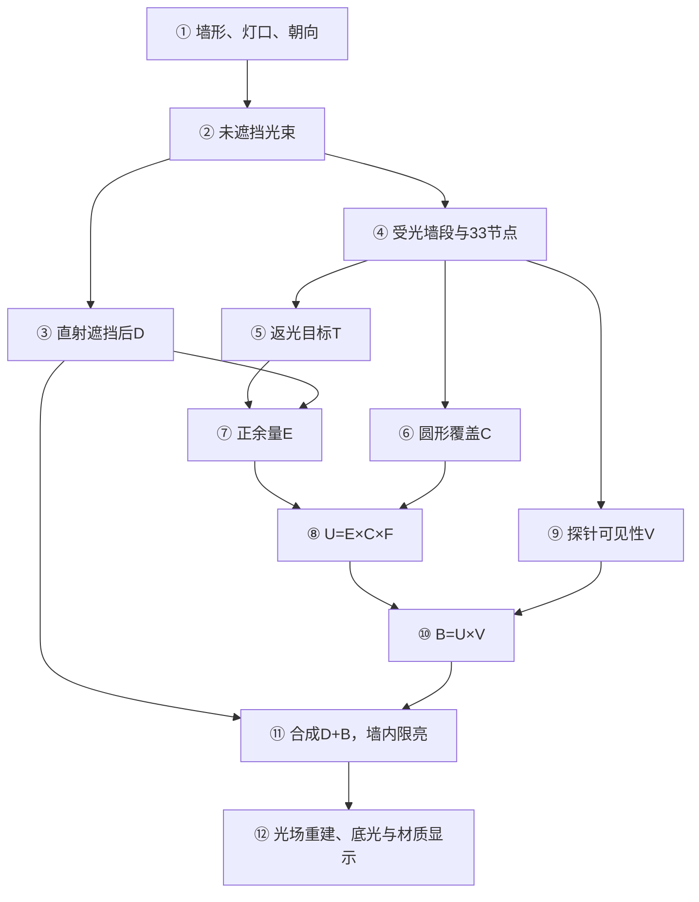
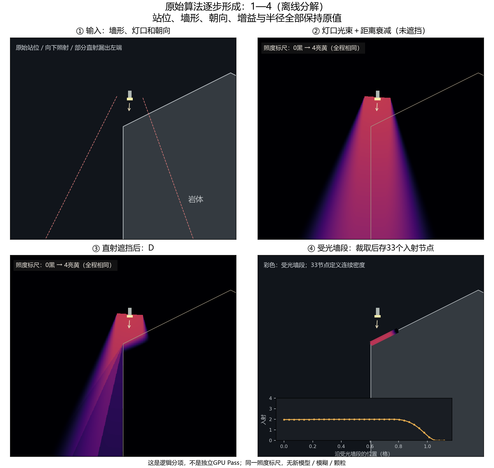
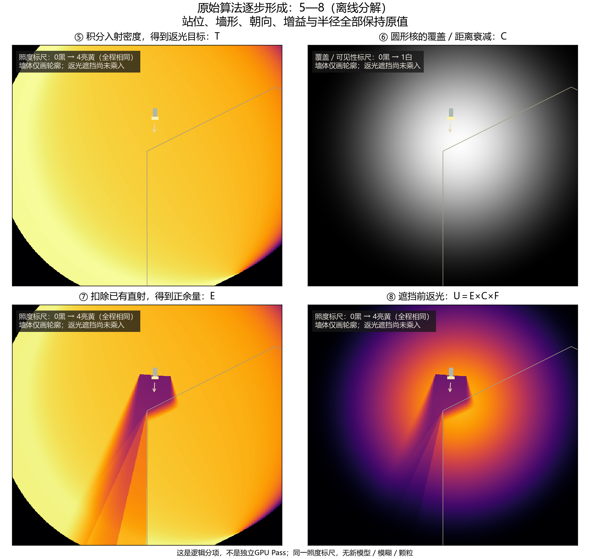
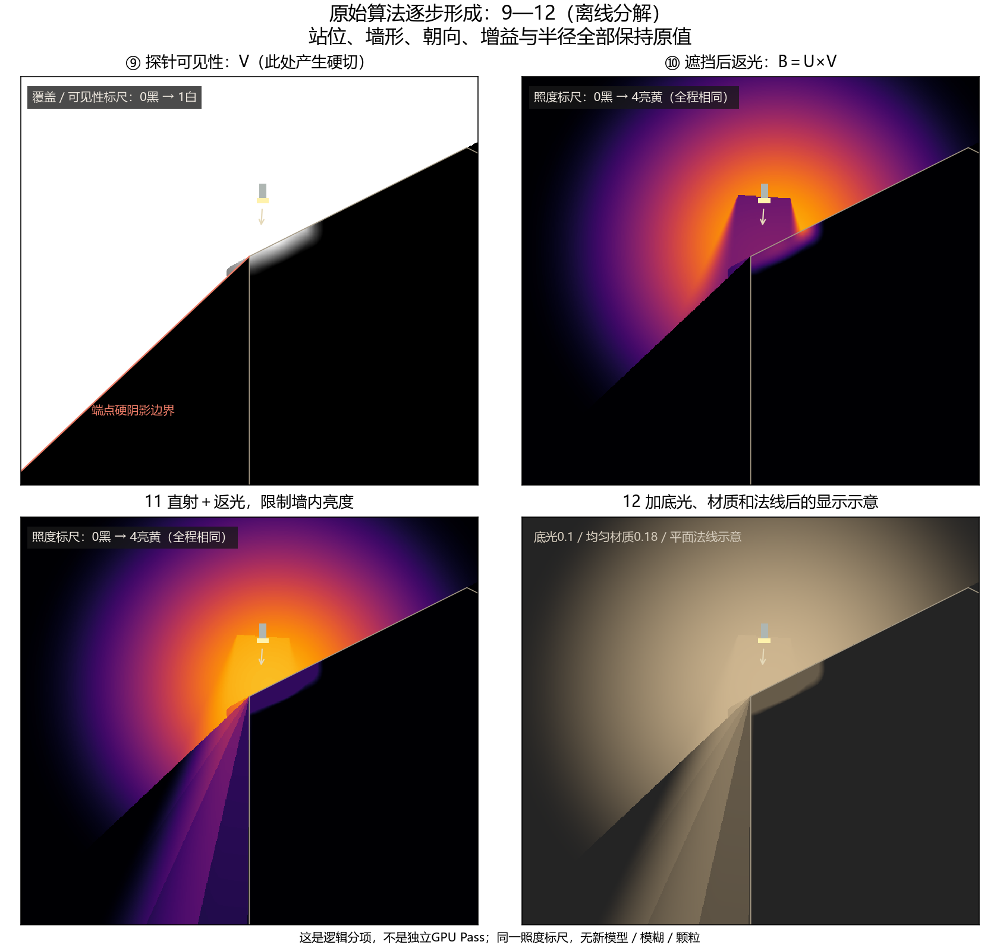
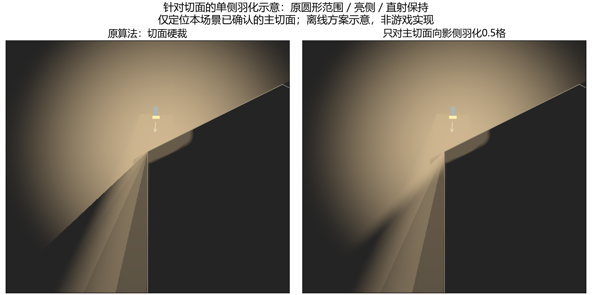
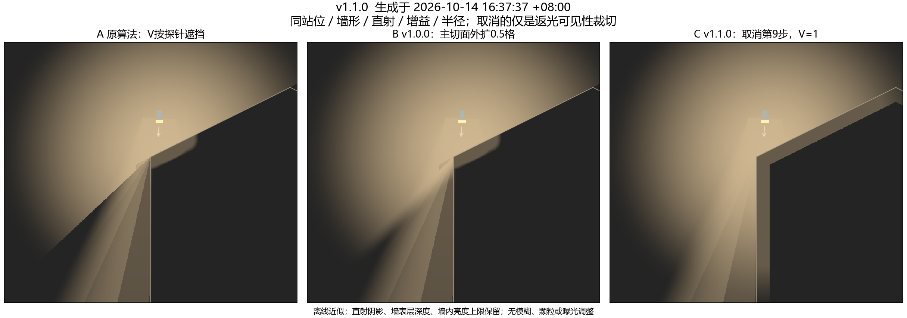
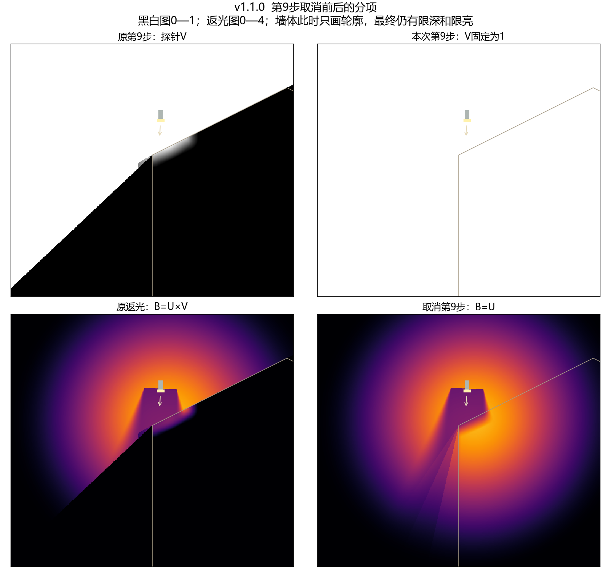
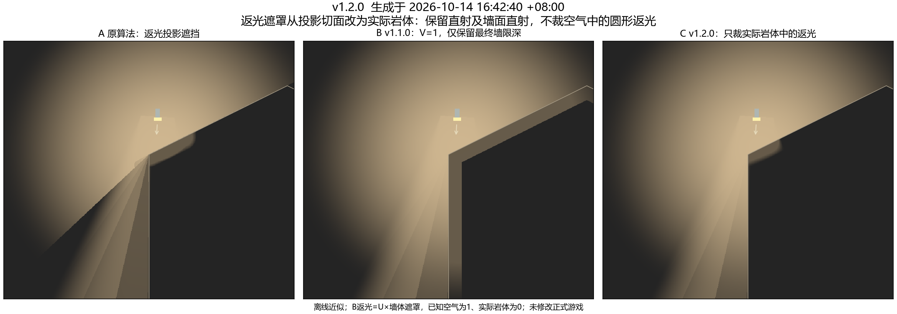
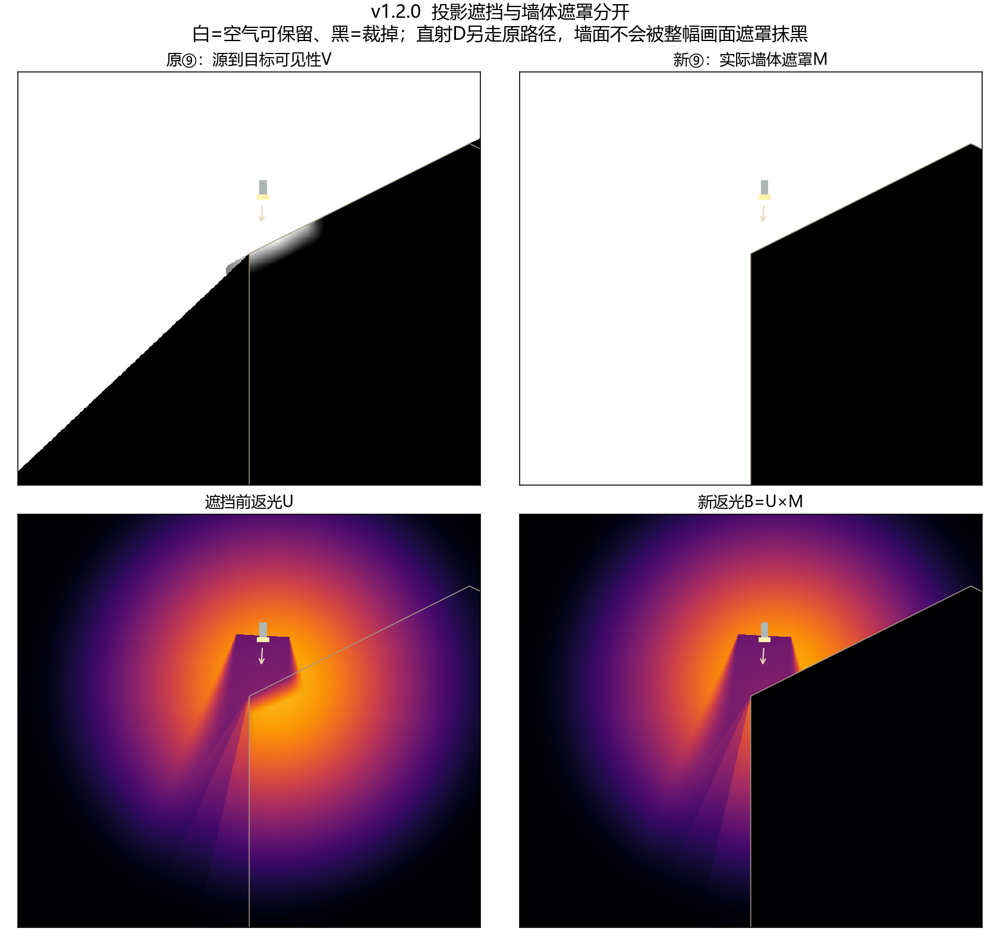

# 斜墙返光离线演算版本记录

本记录保留当前斜墙、站位和向下照射条件下的原始12步分解、切面单侧羽化及遮罩替换对照。v1.0.0作为用户要求保留的比较基线；v1.1.0为取消第⑨步的中间对照；v1.2.0按用户补充，将返光投影切面替换为实际墙体遮罩。三版均为离线演算，未接入正式游戏。

后续用户已授权将三种遮挡规则接入游戏，实施状态见[当前执行状态](../DEVELOPMENT.md#lighting-occlusion-rules)及[实施证据](lighting-occlusion-rules-20261014.json)。以下时间、源码快照和核验均代表离线归档当时，未按后续游戏源码重生成；游戏中的端部外扩为同预算近似，未以本离线图签署画面验收。

## 版本与时间

时间统一为Asia/Shanghai（UTC+08:00）。v1.0.0此前没有独立生成日志，以下原图时间取自归档时核验的文件写入时间，归档时间另列，不倒填为当时的主动日志。

| 版本 | 内容 | 原图时间或生成时间 | 归档完成时间 | 身份清单 |
| --- | --- | --- | --- | --- |
| v1.0.0 | 原始12步、三张汇总、主切面向影侧羽化0.5格 | 原图写入2026-10-14 16:19:57—16:20:00 +08:00 | 2026-10-14 16:35:32 +08:00 | [manifest.json](lighting-slope-simulations-20261014/v1.0.0/manifest.json) |
| v1.1.0 | 固定第⑨步V=1，保留其他计算 | 生成2026-10-14 16:37:37 +08:00 | 2026-10-14 16:37:41 +08:00 | [manifest.json](lighting-slope-simulations-20261014/v1.1.0/manifest.json) |
| v1.2.0 | 返光只裁实际岩体，保留原直射及墙面直射 | 生成2026-10-14 16:42:40 +08:00 | 2026-10-14 16:42:44 +08:00 | [manifest.json](lighting-slope-simulations-20261014/v1.2.0/manifest.json) |

每版清单保存图像、脚本、报告的相对路径、字节数和SHA-256。v1.0.0另保留原路径及原文件时间，原图按字节复制，`artifacts/lighting-slope-analysis-20261014/`中的输入未移动或重生成。版本号用于本组离线演算，不代表游戏发布版本。

## 固定输入

| 项目 | 三版共同输入 |
| --- | --- |
| 灯口位置 | (-0.75, 1.1) 格 |
| 朝向 | -93.44°，接近竖直向下 |
| 斜墙多边形 | (-1,0)、(3,2)、(5,1)、(5,-6)、(-1,-6) |
| 灯具 | Range=24，Cone=46.2°，ApertureWidth=0.967，Intensity=2.78，Softness=0.22，ConeFeather=0.119 |
| 返光 | Continuous／SoftBlob，MatchIncident=true，Gain=2，MaxReach=4.69，Near=5，Far=6，Probes=2 |
| 本场景受光段 | 起点(-1,0)，长度1.11803398875格，33节点；距离门控F=1 |
| 场景 | Ambient=0.1，WallDepth=0.375，WallStrength=0.65，Relief=0.22 |
| 显示 | 672×600数学场；均匀材质0.18、平面法线、固定曝光；无颗粒、无图像模糊 |

该多边形和站位沿用此前斜墙演算，未声称精确重建游戏截图中的全部洞穴。游戏实际384×216光场的半精度存储、作者纹理及完整重建未由本图复现。

## v1.0.0 原始流程与切面单侧羽化

下图为逻辑依赖，不代表12个独立GPU Pass。墙面入射会按光束和遮挡公式另算，不从直射光场贴图取值。



| 步骤 | 形成方式 |
| --- | --- |
| ①—③ | 灯口、锥角与距离衰减产生未遮挡光束，再经过五个采样口的遮挡计算得到D；部分直射从墙角左侧漏出。 |
| ④ | 裁取受光墙段，再重新计算33节点入射；节点定义连续密度，不是独立点光。 |
| ⑤ | 积分得到局部照度I；当前匹配模式T=2×(0.8I+0.2M)，M为墙段匹配平均照度。 |
| ⑥ | 径向核积分得到覆盖C，负责圆形外围渐变；本场景距离门控F=1。 |
| ⑦—⑧ | 平滑正余量E近似max(T-D,0)，扣除直射后形成补光缺口；U=E×C×F，此时尚未乘返光遮挡。 |
| ⑨—⑩ | 两探针按距离加权得到V。在本角落两探针钳到同一端点，V可从1跳至0；B=U×V将圆润光团硬切。 |
| ⑪—⑫ | 本模型仅一条受光墙段，八槽融合退化为单段；加直射、墙内限亮，再以底光和均匀材质示意最终显示。 |







单侧羽化仅针对已定位的主切面，以切面距离在影侧扩展0.5格，不改变圆形核、直射或出射方向分布；实墙由短空气路径约束。不是对任意墙形完成了通用切面提取。



分解返光和原算法的最大差异为0；单侧羽化后的亮侧、实墙及带外返光差异均为0，详见[原始分解报告](lighting-slope-simulations-20261014/v1.0.0/reports/original-pipeline-result.json)及[羽化核对](lighting-slope-simulations-20261014/v1.0.0/reports/one-sided-cut-feather-scene-result.json)。

## v1.1.0 取消第⑨步

本次唯一变化是把返光V固定为1：原式`B=U×V`改为`B=U`。直射阴影、墙面入射准备、原光团及正余量、距离门控、墙内最大深度0.375、亮度上限0.65、底光与显示参数全部保留。不叠加出射投影、模糊或曝光补偿。





在这一场景中，取消⑨后切面与暗楔明显被补亮，圆形返光恢复得更完整。样点(-1.25,-1)原返光为0，取消后为1.69851；其直射仍为1.24748。原先被返光遮挡测试排除的空气点现在也能收到返光，最终墙深度裁剪不能代替这条源到目标的遮挡关系；本对照不等于其他洞室、薄墙或多灯条件下不会漏光。

原算法重算与v1.0.0场值最大差异为0，`B=U`核对差异为0，输出有限且返光不减少。具体数值及采样点见[result.json](lighting-slope-simulations-20261014/v1.1.0/result.json)。

## v1.2.0 将切面遮罩改为实际墙体遮罩

用户进一步明确：“取消第⑨步不意味着不切掉墙体遮罩部分，可能需要把切面遮罩改为墙体遮罩”。本版据此分开两种判断：原V判断返光源到目标的路径是否被墙挡住；新墙体遮罩M只判断目标点本身是否为岩体。M在已知空气中为1，在实际岩体或未知区域为0；本演算将图中整个矩形视为已知区域，未知区域拒绝没有单独模拟。

返光改为`B=U×M`，直射D及其遮挡仍走原路径。合成仍为`D+B`，保留原墙深度与墙内限亮；不能用M去乘整幅最终画面，否则会连墙面原有直射一起抹掉。本版没有模糊、扩大返光半径或改变圆形核，也没有新增出射方向衰减。



上图C为本次结果：空气中的圆形返光不再被延长的斜向阴影线切断，原暗楔得到补光；实际岩体中的返光为0，斜墙受直射的表层仍保留。B与C在空气中的返光完全一致，区别是C去掉了B中沿岩体表层出现的返光亮带。本版也会移除原本落在墙体材质中的间接光；若以后要保留墙面间接受光，需要单独定义该表层的接收规则，不能从本图推断已保留。



离线核对中，岩体内返光最大值为0，空气中相对v1.1.0的返光差异为0，岩体中的合成光与原直射D差异为0；重算原返光与冻结基线差异为0，详见[result.json](lighting-slope-simulations-20261014/v1.2.0/result.json)。

目标点的墙体遮罩不表达光从哪里到达，因此另一堵墙背后的空气仍可能收到这个圆形场。本版消除了本场景的返光投影切面，未证明薄墙、邻洞或多灯遮挡成立。这里只替换了离线公式，没有新增GPU Pass；正式实现能否复用现有地图采样、节省多少射线开销及多灯总成本，均未由本演算测量。

## 生成脚本与复现

- [v1.0.0生成脚本](lighting-slope-simulations-20261014/v1.0.0/generator-source/render_original_light_pipeline.py)及同目录三个依赖模块按原字节冻结；对应六份游戏Shader源码保存在该版`game-source/`。
- [v1.1.0生成脚本](lighting-slope-simulations-20261014/v1.1.0/generator-source/generate_skip_step09_v1_1.py)只读取冻结的v1.0.0数学模型，先核验输入SHA-256。
- [v1.2.0生成脚本](lighting-slope-simulations-20261014/v1.2.0/generator-source/generate_wall_mask_v1_2.py)读取同一冻结模型，核验v1.0.0及v1.1.0身份，再计算实际岩体遮罩。
- [统一复现入口](lighting-slope-simulations-20261014/reproduce.py)只接受新的输出目录，拒绝覆盖版本和历史结果。v1.0.0报告的游戏源码身份从冻结副本取值，不受后续正式Shader修改影响。

实际环境为Python3.13、NumPy2.2.6、Matplotlib3.10.8，字体`C:/Windows/Fonts/msyh.ttc`。在仓库根目录执行，例如：

```powershell
& 'C:/Users/Jobscn/AppData/Local/Programs/Python/Python313/python.exe' `
  'docs/evidence/lighting-slope-simulations-20261014/reproduce.py' `
  v1.2.0 --output 'artifacts/lighting-slope-replay-v1.2.0-new'
```

将版本参数换成`v1.0.0`或`v1.1.0`可重建前版，但输出目录也必须另取新名。复现会生成离线图片与报告，不启动Unity。当前记录仅签署文档、图像保全和离线公式核对；游戏源码、作者参数、YYGC、协议／存档／依赖均未因本次演算修改，未进行Unity编译、Play、Player或GPU性能验收。

2026-10-14 16:47:29—16:47:33 +08:00，用统一入口在新目录`artifacts/lighting-slope-replay-v1.2.0-record-check/`复现v1.2.0，五项核对与冻结报告一致。版本文件字节数／SHA-256、文档相对链接及复现结果的最终核对见[记录核验](lighting-slope-simulations-20261014/record-verification.json)。
