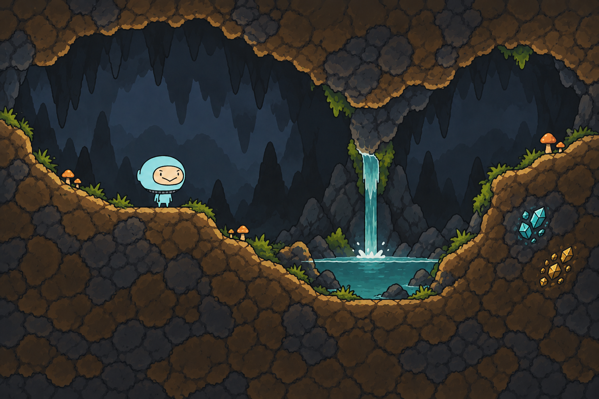
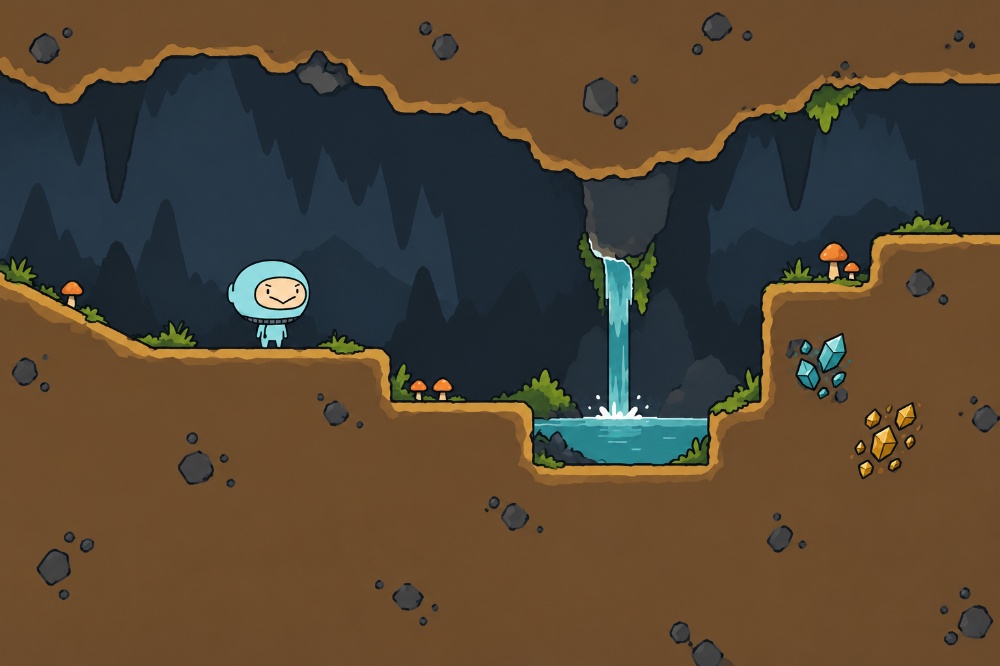

# DualGrid与原主角配套画法

2026-10-31，按用户“基于当前游戏DualGrid tile和原主角重新画一张设计图”的要求制作，归CL-01／08。后续用户明确认可所附较丰富岩纹版本，并要求减少方正感；当前新增自然洞形稿待评审，未批准替换正式资源。

## 自然洞形延展

`dualgrid-cave-organic.png`为1536×1024不透明概念：保留用户选定的碎岩纹理、原主角色彩／比例及生态，将长平台和直角断岸改为短坡、斜切岩肩、岩舌与不对称凹岸，池面保持水平；洞顶改为不对称拱顶及局部压低岩肩。局部块形仍按可复用方向构思，但画中每一处小凸凹不自动成为权威碰撞。

原附件字节另存`organic-reference.png`；制作前合同、完整编辑提示及输入／输出身份分别见`organic-brief.json`、`organic-prompt.txt`和`organic-generation-record.json`。本次使用内置生图，人物为参考重绘，水与植物仍是未来动态层的静态设计。自然轮廓是否能由现有坡形准确表达，须在正式tile制作时逐项核对。

## 前批探索

- `dualgrid-cave-clean.png`：1536×1024，不透明场景设计图。简洁土岩填充、薄亮边与暗内缘表现厚度，局部小石块、草、橙菇、矿斑和短瀑形成辨识。
- `dualgrid-cave-detail-draft.png`：同尺寸初稿，保留偏密的碎岩纹理；后一次定向简化只以减少表面细节为目标。
- `brief.json`记录制作前尺寸、用途、透明／共边／形状精度与方法。`prompt.txt`、`refine-prompt.txt`保存两次完整提示；`generation-record.json`记录原生输出、输入和SHA-256。均使用内置生图，工具未暴露实际模型ID。

输入为原主角比例图与正式工程现有`cave-dualgrid.png`。实现调查只读`CaveTerrainAssets.cs`、`SOURCE.md`、`CavePixelRock.shader`和现行地形合同：已有四角掩码图集、独立坡形裁切、矿层和背景，不需要以大幅独特岩体构图作为每处地形的前提。

| 部分 | 后续制作落点 |
| --- | --- |
| 地形轮廓 | 沿现有16种四角掩码制作确定性边缘，直边、凹凸角和内填统一共边 |
| 坡面 | 对应正式坡形的独立形状与相同碰撞公式，不能拿图上的圆角代替坡形 |
| 内填 | 少量安静底色与本地小石块变体；新增采掘边不依赖完整大石构图 |
| 矿物 | 继续独立矿层；图中矿斑不是初始墙后储量透视或正式矿床布局 |
| 草、蘑菇和水 | 独立切出图／支点／运动，水面、瀑身、飞沫分别制作；当前图仅说明造型与位置 |
| 后壁 | 低对比独立层，前景采空后沿正式冻结背景合同显示 |

人物由生图按原参考重绘，不能宣称原精灵精确合成。两张整景都不是可直接切片的合格DualGrid atlas，也不证明像素共边、全部坡形、碰撞或动态循环；最终小尺寸tile须用确定性工具制作并按原生尺寸检查。清简版仍有少量宽范围色调变化，正式图集再明确调色板与透明边缘。

本批只制作和目视检查设计图，未修改旧演示、Game、YYGC、原人物／Spine、正式图集或玩家存档，未运行Unity／Play／测试。
