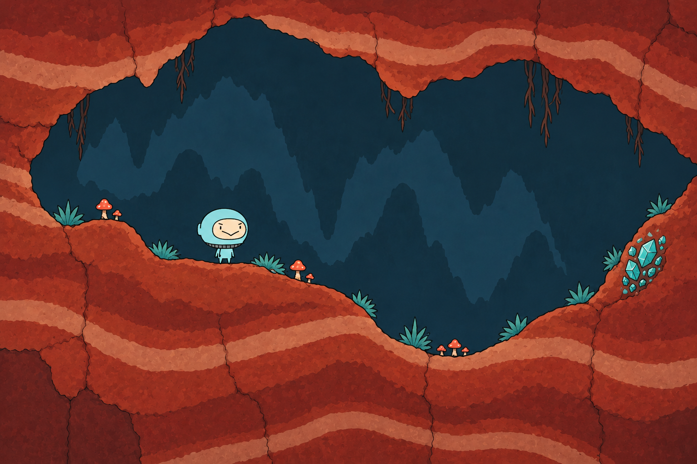
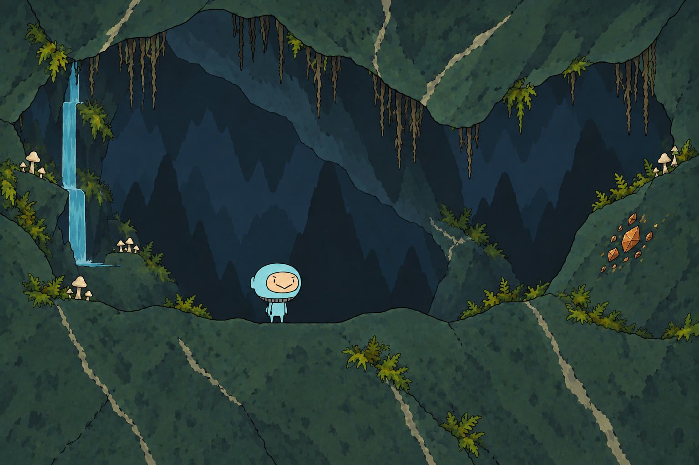
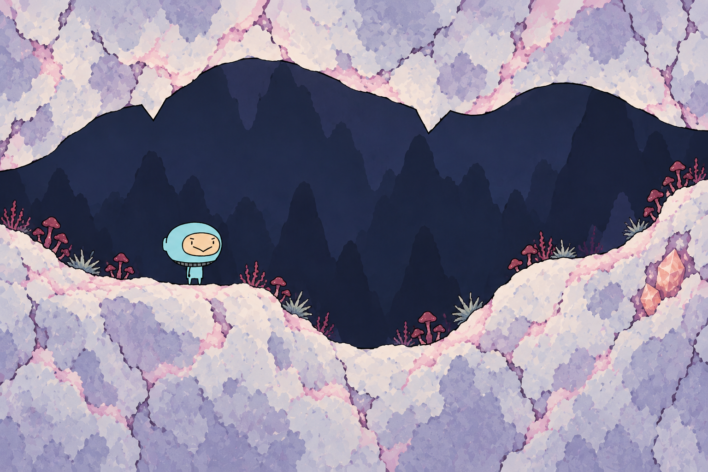

# 严格正侧视三材质修正

2026-11-01，用户指出前批微弱透视与实际实现不符，本轮保留赭红／石绿／月白三种材质及原主角，改为扁平侧视截面，归CL-01／08，待视觉评审。三张最终图均为1536×1024原生PNG，共约5.84MiB，没有缩放或覆盖旧图。

## 当前投影要求

角色直接站在空实轮廓线上，轮廓下方为岩层截面，不再露出行走顶面、前后两条路沿、向画面深处延伸的地面或挤出的岩台。二维起伏由轮廓决定，岩层纹理画在实心区域内；背景保留低对比平面剪影。水面使用正侧视线条，不画椭圆池面。

这取代前批“露出少量顶面表现厚度”的美术目标；旧图保留为配色与材质来源，不能视为已接受的投影实现。

## 最终候选

赭红版保留沉积带，石绿版保留斜矿缝，月白版保留浅色矿壳；三者的空间形状均以平面截面导图为输入。导图只约束二维投影与大致构图，生成轮廓并非逐像素一致，人物位置和尺度也略有差异。

石绿初稿`02-sage-flat-draft.png`仍有亮色边带和岩片明暗，容易读成顶面；保留初稿，并以`prompt-02-refine.txt`定向移除该效果，最终采用`02-sage-flat.png`。

## 来源与记录

- `brief.json`记录制作前原生尺寸目标、用途、透明／共边／形状精度与方法理由。
- `flat-shape-guide.svg`是可编辑的确定性二维空实导图；`flat-shape-guide.png`是同尺寸渲染输入。导图不替代正式图集或碰撞。
- `prompt-01.txt`～`prompt-03.txt`与`prompt-02-refine.txt`保存四次完整提示；`input-identities.json`、`generation-record.json`记录输入／输出SHA-256、原生尺寸、工具源路径、修正过程和目视核对。
- 使用内置`image_gen.imagegen`，工具未暴露实际模型ID。原主角完整比例图与头罩是直接输入，人物仍为参考重绘。原主角目录12个PNG／Spine文件与前批三张材质图的字节均未变化。

本轮只修正静态概念的投影。局部手绘色块、矿石切面仍用于材质，不代表三维网格；正式DualGrid共边、坡形、WFC规则、碰撞与真实镜头仍未制作／验证。动态水流、植物与矿屑继续需要独立资源。未修改Game、YYGC、依赖或玩法，未启动Unity编译、测试、Play或Player。
