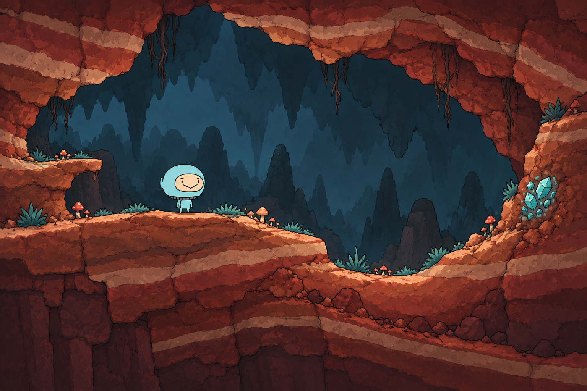
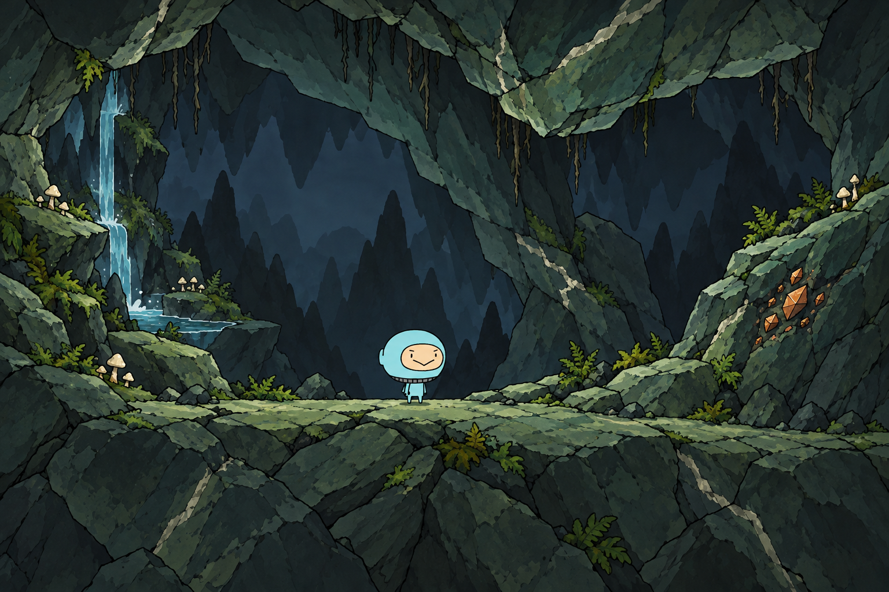
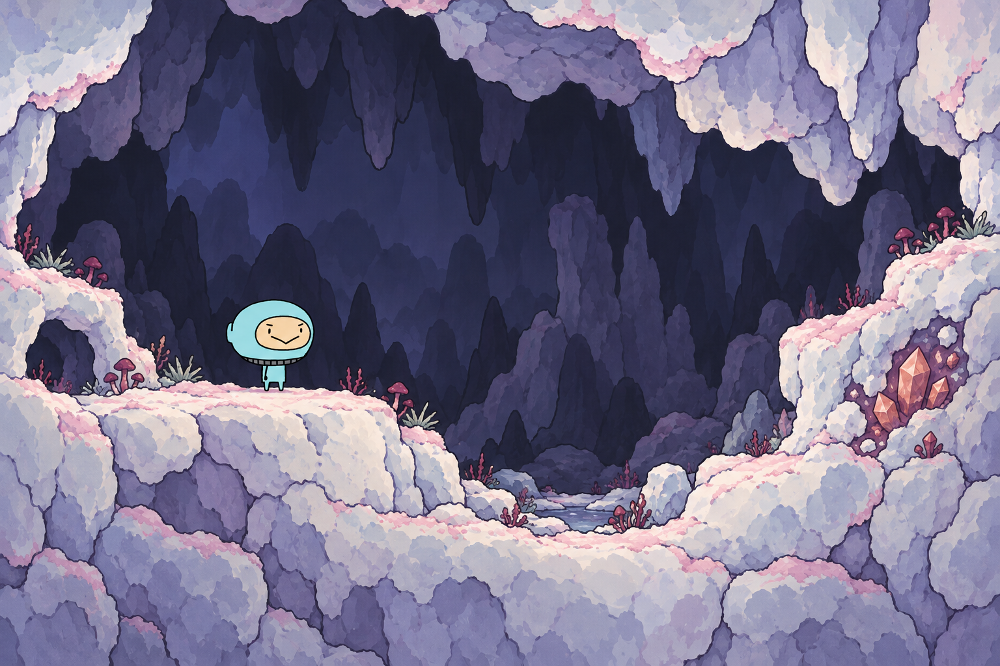

# 原主角与异色岩层探索

2026-11-01，按用户“地块不一定是黄灰组合、角色贴近真实主角”的要求制作三张静态概念图，归CL-01／08，待视觉评审。三张均为1536×1024原生PNG，约6.70MiB，没有缩放或覆盖前批图片。

用户后续明确要求扁平正侧视，本批可见顶面与微弱透视不再作为实现目标；三张保留为材质／色彩来源，投影修正版见[严格正侧视候选](../20261101-hero-terrain-flat-v2/README.md)。

## 三个方向

| 图 | 材质与形状 | 色彩关系 |
| --- | --- | --- |
| `01-terracotta-strata.png` | 赭红沉积岩，长沉积带、风化岩台、宽缓凹地 | 砖红／暗酒红岩层、浅鲑色露面与蓝绿远景；突出浅蓝主角 |
| `02-sage-slate.png` | 石绿板岩，大块斜裂岩片、白色细矿缝、附壁岩肩 | 灰绿／深松绿岩体、铜橙露矿，左侧湿润生态 |
| `03-moonwhite-salt.png` | 月白盐岩，圆润溶蚀岩团、浅凹槽与矿壳 | 月白／灰紫岩面、淡粉矿壳和酒红菌丛；深色后壁衬出人物 |

## 主角参考与制作记录

制作前直接查看原`角色/主角/images/head.png`与`body.png`，并使用既存`20261029-wfc-cave-kit/sources/hero-scale-reference.png`完整主角作为首要生图输入；头罩部件作第二输入，上一批附件只提供环境线条与层次参考，不继承黄灰地色。

这轮重点保留原主角的大头小身、浅蓝平涂、米色脸、斜眉、V形嘴和灰色分节颈圈。三张人物仍为AI参考重绘，尺寸和细节有漂移，不能宣称原精灵逐像素合成。正式入景应直接使用原Spine表现，并按真实相机统一尺度与受光。

- `brief.json`：制作前尺寸、透明／共边／形状精度、方法理由与参考角色。
- `prompt-01.txt`～`prompt-03.txt`：三次完整提交提示。
- `source-identities.json`：原主角目录12个文件及三项生图输入的尺寸／SHA-256；收尾已核对原PNG和Spine字节未变化。
- `generation-record.json`：内置`image_gen.imagegen`工具源路径、原生尺寸、输出身份与目视核对。工具未暴露实际模型ID。

## 选择与后续边界

赭红方向与浅蓝主角的冷暖区分最直接；石绿方向更适合作为湿润矿区；月白方向适合特殊矿层，但当前浅色矿壳也可能被读成霜雪，若选用需进一步明确盐岩材质。三张的表面纹理比原人物丰富，生产稿仍应按真实镜头控制纹理密度。

本轮仅比较静态美术方向，没有制作正式DualGrid图集、共边端口、WFC规则、碰撞或采矿判定。流水、草／菌菇／根系及短时矿屑需要独立资源和动态，不能把整张图作为最终地形。未修改原素材、Game、YYGC、依赖或玩法，未启动Unity编译、测试、Play或Player。
