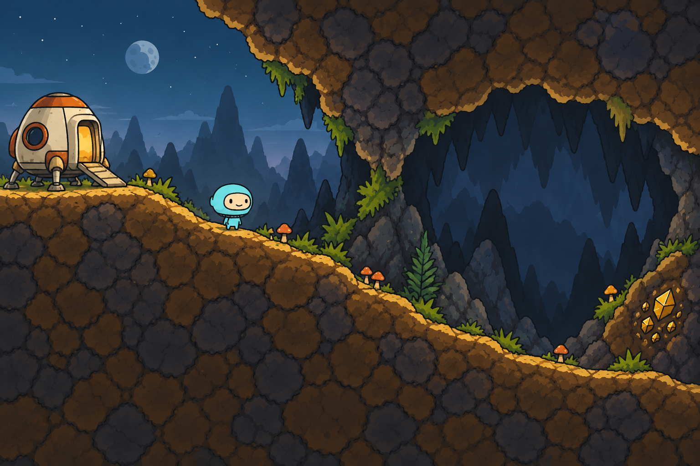
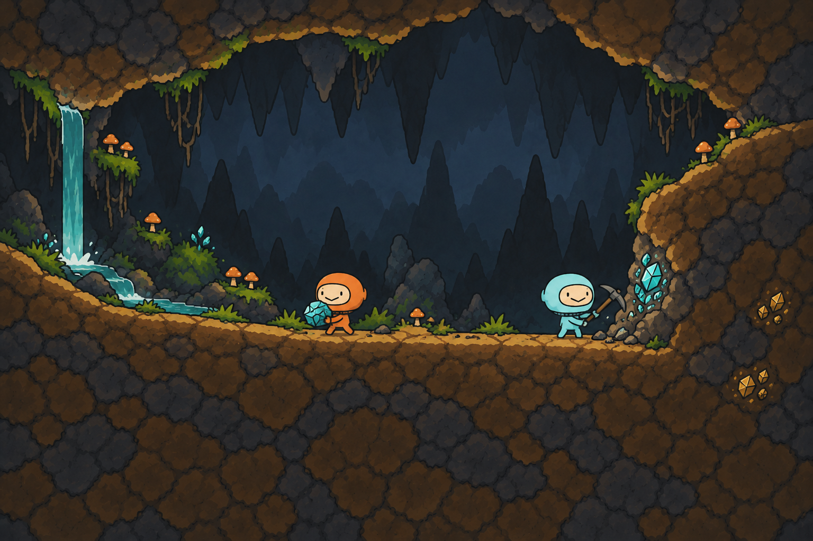

# 星球抵达与地下采矿概念

2026-11-01，按用户“再做两张效果图，符合到一个星球、下地底挖矿”的要求制作，归CL-01／08，待用户视觉评审。沿用最新附件的手绘轮廓、暖褐岩体、蓝灰后景、自然坡面与浅蓝主角；两张均为原生1536×1024不透明PNG，没有缩放或改写生成原图。

## 01 抵达星球，找到洞口

小型降落舱落在左侧地表，暖色舱门与冷色夜空形成返回地标；连续下行坡道经过厚岩洞檐进入右侧洞穴。地表与洞内共用岩石画法，通过天空、洞顶、植被与远景层次表现过渡，远端少量露矿引导探索。

## 02 深入地底，采矿与搬运

右侧岩壁的浅矿窝容纳采矿动作，浅蓝角色持镐、橙色同伴搬矿向左返回。左侧水流、苔藓、根系和菌菇形成湿润区域，与右侧工作面拉开构图；厚前景岩体与低对比后壁保持层次。

## 来源与后续制作边界

- 使用内置`image_gen.imagegen`，参考图引导两次独立场景生成，工具未返回实际模型ID。
- `user-style-reference.png`保留此次用户附件的原字节；`brief.json`记录制作前合同，`prompt-01.txt`／`prompt-02.txt`为两张完整提交提示，`generation-record.json`记录工具源路径、原生尺寸、字节、SHA-256、目视核对及限制。
- 这两张是静态美术概念，不是可切片的正式图集。前景形状、顶面、后壁、矿层和装饰须分开制作；像素共边、DualGrid掩码、坡形／碰撞及WFC端口需在正式素材阶段另验。
- 动态版本应将瀑身、流水、水面／飞沫分开，将草、菌菇与根系按支点独立摆放；采矿敲击、掉屑和粉尘为短时独立效果，不能烘在地形里。这里没有制作循环动画、Spine绑定或运行粒子。
- 人物与工具为AI参考重绘，表情、比例和持镐姿势并非原精灵精确合成。局部连续亮边及画中前岩矿斑仍需在后续生产稿中按真实镜头、矿物可见性和采掘规则收敛。

本轮只生成、保存和目视检查两张图；未修改原人物、Spine、Game、YYGC或正式玩法，未启动Unity编译、测试、Play或Player。降落舱仅用于本次“抵达星球”的视觉叙事，不改变暂停／开放玩法边界。
